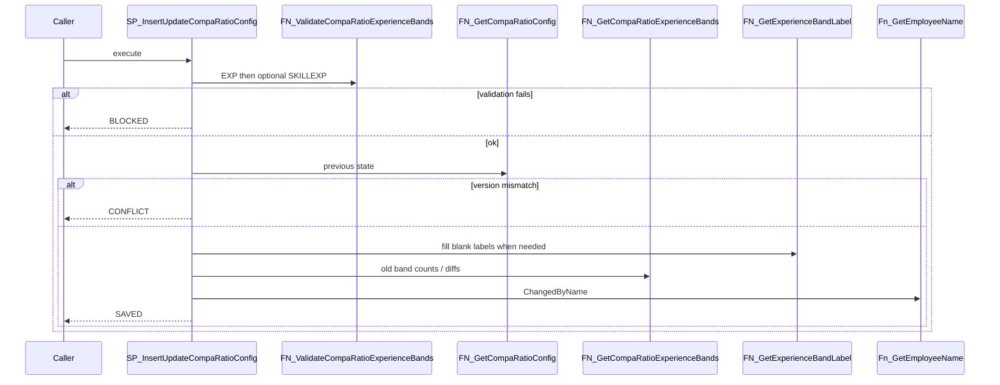
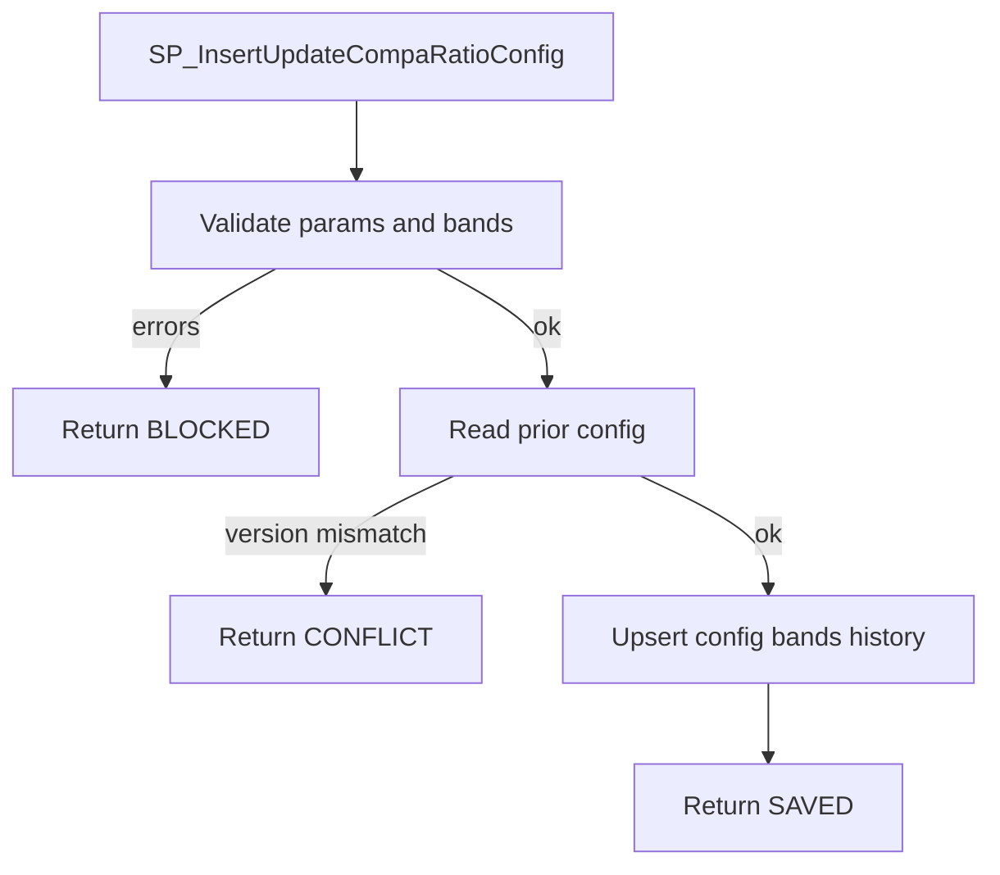

# SP_InsertUpdateCompaRatioConfig

## What it does

Persists an organisation's Auto Compa-Ratio configuration after the admin confirms Submit or Update. Validates Min skills and band TVPs, enforces optimistic concurrency on `ConfigVersion`, upserts `TCompensationCompaRatioConfig`, replaces Experience bands (and Skill Experience bands when that panel is in play), appends Change History with a JSON snapshot, and returns `SAVED`, `BLOCKED`, or `CONFLICT`.

## Parameters

| Name | Direction | What it is for |
|---|---|---|
| `@EmployerId` | in | Organisation to save |
| `@LoggedInEmployeeId` | in | Actor for audit / history |
| `@IsEmploymentTypeEnabled` | in | Optional matching toggle |
| `@IsQualificationEnabled` | in | Optional matching toggle |
| `@IsLocationEnabled` | in | Optional matching toggle |
| `@IsGradeEnabled` | in | Optional matching toggle |
| `@IsBusinessUnitEnabled` | in | Optional matching toggle |
| `@IsSkillsEnabled` | in | Optional matching toggle |
| `@IsSkillExperienceEnabled` | in | Forced off when Skills is off |
| `@MinSkillsToMatch` | in | 1–10; defaults to 2 when null |
| `@ExpBands` | in | Experience band TVP |
| `@SkillExpBands` | in | Skill Experience band TVP |
| `@ExpectedConfigVersion` | in | Optimistic concurrency; null skips the check |
| `@AutoRelabelBands` | in | When 1, regenerate every band label |
| `@IncludeBandValueDiff` | in | When 1, log band value edits without count change |

## Call sequence

## Callers

Procedures and functions that call this object.

No other procedure or function calls this object. Node DAL `InsertUpdateCompaRatioConfig` executes it for Admin Configuration Submit/Update.

## Nested

| Object | Kind | When | Page |
|---|---|---|---|
| `FN_ValidateCompaRatioExperienceBands` | function | always for EXP; SKILLEXP when in play | [FN_ValidateCompaRatioExperienceBands](/docs/database/hrms/FN_ValidateCompaRatioExperienceBands) |
| `FN_GetCompaRatioConfig` | function | previous state / concurrency | [FN_GetCompaRatioConfig](/docs/database/hrms/FN_GetCompaRatioConfig) |
| `FN_GetCompaRatioExperienceBands` | function | old counts, optional value diff, SKILLEXP snapshot | [FN_GetCompaRatioExperienceBands](/docs/database/hrms/FN_GetCompaRatioExperienceBands) |
| `FN_GetExperienceBandLabel` | function | blank or auto-relabel bands | [FN_GetExperienceBandLabel](/docs/database/hrms/FN_GetExperienceBandLabel) |
| `Fn_GetEmployeeName` | function | history ChangedByName | [Fn_GetEmployeeName](/docs/database/hrms/Fn_GetEmployeeName) |

## Steps

1. Force Skill Experience off when Skills is off; default Min skills to 2 (`STOREPROCEDURE/SP_InsertUpdateCompaRatioConfig.sql`).

2. Collect validation errors into `#Err` (Min skills range + `FN_ValidateCompaRatioExperienceBands`). On any error, return BLOCKED with RS2 errors.

3. Read prior config via `FN_GetCompaRatioConfig`. If `@ExpectedConfigVersion` differs, return CONFLICT.

4. Normalise band TVPs into `#NB` (renumber, open-ended last row, labels via `FN_GetExperienceBandLabel` when blank or `@AutoRelabelBands = 1`).

5. Build Change Description from toggle / Min skills / band-count (and optional value) diffs. Resolve actor name via `Fn_GetEmployeeName` and employment number from `TEmployeeInfo`.

6. In a transaction, upsert `TCompensationCompaRatioConfig`, replace EXP bands, replace SKILLEXP bands only when that panel is in play, insert `TCompensationCompaRatioConfigHistory` with JSON snapshot, commit, return SAVED.

## Tables

| Table | Read or write |
|---|---|
| `TCompensationCompaRatioConfig` | read / write |
| `TCompensationExperienceBand` | write (delete/insert) |
| `TCompensationCompaRatioConfigHistory` | write |
| `TEmployeeInfo` | read |
| `TCompensationExperienceBandDefault` | read via nested band function when no saved bands |

## Flow

