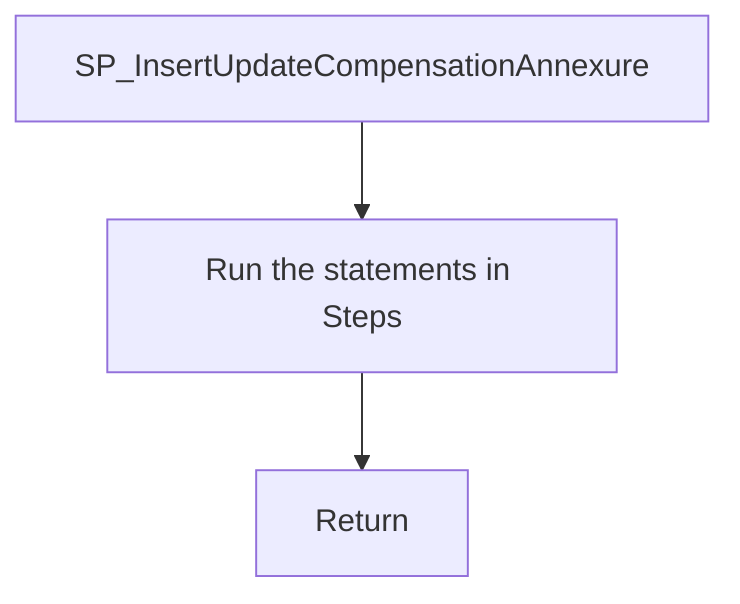

# SP_InsertUpdateCompensationAnnexure

## What it does

Inserts or updates a CompensationAnnexure row. Ensures Fixed/Variable/Total components from the employer DefaultCompensationStructure are included in ComponentId.

## Parameters

| Name | Direction | What it is for |
|---|---|---|
| `@CompensationStructureId` | in | Linked structure |
| `@employerId` | in | Employer |
| `@employeeId` | in | Actor |
| `@AnnexureId` | in | 0/null insert; else update |
| `@AnnexureName` | in | Name |
| `@EffectiveFrom` | in | Effective date |
| `@AnnexureStatus` | in | Active bit |
| `@AnnexureDesc` | in | Description |
| `@AssignedBUs` | in | CSV business units |
| `@AssignedLocations` | in | CSV locations |
| `@ComponentId` | in | CSV components |
| `@Notes` | in | Notes |
| `@NotesToggle` | in | Notes flag |
| `@ColouredComponentId` | in | Highlighted components |
| `@UpdateFlag` | in | Update flag |
| `@Currency` | in | Currency |
| `@ValidatedComponentIds` | in | Validated component flags |
| `@AssignedDesignations` | in | CSV designations |
| `@AssignedGrades` | in | CSV grades |
| `@AssignedEmploymentTypes` | in | CSV employment types |

## Call sequence

Calls no other procedures or functions.

## Callers

No other procedure or function calls this object.

## Nested

Calls no other procedures or functions.

## Steps

1. Normalize empty ComponentId/Notes to null.
2. Append Fixed/Variable/Total component ids from DefaultCompensationStructure when missing.
3. If AnnexureId is 0/null, insert CompensationAnnexure.
4. Else update the annexure row including assignments and components.

## Tables

| Table | Read or write |
|---|---|
| `dbo.CompensationAnnexure` | write |
| `dbo.TCompensationStructure` | read |
| `dbo.TEarningSalaryComponents` | read |

## Flow

