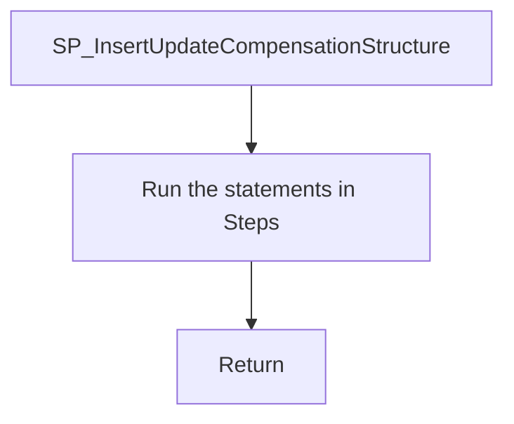

# SP_InsertUpdateCompensationStructure

## What it does

Creates a compensation structure (optionally copying components) or updates an existing structure name, currency, and component id list. On create, seeds components from master or from a copy source.

## Parameters

| Name | Direction | What it is for |
|---|---|---|
| `@CompensationStructureId` | in | Null for insert |
| `@employerId` | in | Employer |
| `@employeeId` | in | Actor |
| `@CompensationStructureName` | in | Name |
| `@ComponentIds` | in | Extra ids appended on update |
| `@IsCopy` | in | Copy flag |
| `@CopyFromCompensationStructureId` | in | Source when copying |
| `@Currency` | in | Currency id |

## Call sequence

Calls no other procedures or functions.

## Callers

No other procedure or function calls this object.

## Nested

Calls no other procedures or functions.

## Steps

1. If structure not found, insert TCompensationStructure.
2. If IsCopy = 1, clone earning components and custom formulas from the source structure and remap formula references.
3. Else seed earning components from TComponentsMaster and formulas from TCustomComponentFormulaMaster for the employer.
4. On update, concatenate ComponentIds and update name/currency/audit fields.

## Tables

| Table | Read or write |
|---|---|
| `dbo.TCompensationStructure` | write |
| `dbo.TEarningSalaryComponents` | write |
| `dbo.TCustomFormulas` | write |
| `dbo.TComponentsMaster` | read |
| `dbo.TCustomComponentFormulaMaster` | read |

## Flow

