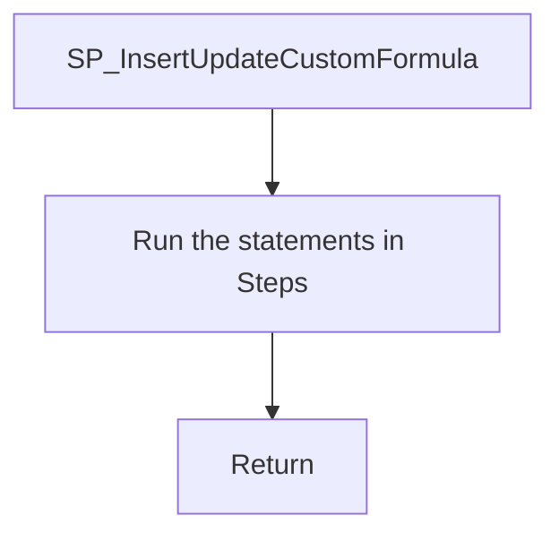

# SP_InsertUpdateCustomFormula

## What it does

Inserts a new custom formula row or updates an existing TCustomFormulas row by CustomConditionId.

## Parameters

| Name | Direction | What it is for |
|---|---|---|
| `@CustomConditionId` | in | Null for insert; set for update |
| `@ComponentId` | in | Owning component |
| `@employerId` | in | Employer |
| `@CustomAmount` | in | Amount |
| `@CustomSecondAmount` | in | Second amount |
| `@CustomOperator` | in | Operator |
| `@CustomFirstComponent` | in | First component ref |
| `@CustomSecondComponent` | in | Second component ref |
| `@CustomFormulaType` | in | Formula type |
| `@CustomPercentageValue` | in | Percentage |
| `@CustomFlatAmount` | in | Flat amount |
| `@isDelete` | in | Soft-delete flag on update |

## Call sequence

Calls no other procedures or functions.

## Callers

No other procedure or function calls this object.

## Nested

Calls no other procedures or functions.

## Steps

1. If CustomConditionId is null, insert into TCustomFormulas.
2. Else update the matching CustomConditionId row including isDelete.

## Tables

| Table | Read or write |
|---|---|
| `dbo.TCustomFormulas` | write |

## Flow

