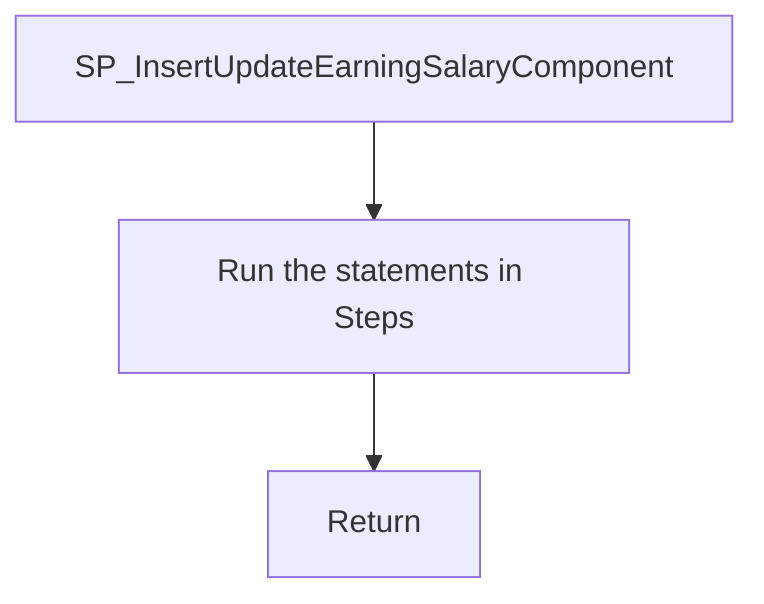

# SP_InsertUpdateEarningSalaryComponent

## What it does

Inserts a new earning salary component or updates an existing TEarningSalaryComponents row. On insert returns the new ComponentId.

## Parameters

| Name | Direction | What it is for |
|---|---|---|
| `@ComponentId` | in | Null/missing for insert |
| `@ComponentName` | in | Name |
| `@employerId` | in | Employer |
| `@employeeId` | in | Actor |
| `@ComponentType` | in | Type |
| `@DisplayName` | in | Display |
| `@CalculationType` | in | Flat or Formula |
| `@SalaryMethod` | in | Method |
| `@SalaryValuePercentage` | in | Percentage |
| `@SalaryComponentId` | in | CSV of related components |
| `@SubtractComponentFromId` | in | Subtract base |
| `@FlatAmount` | in | Flat amount |
| `@FlatAmountFrequency` | in | Frequency |
| `@IsActive` | in | Active flag |
| `@CompensationStructureId` | in | Declared; not used in body |

## Call sequence

Calls no other procedures or functions.

## Callers

No other procedure or function calls this object.

## Nested

Calls no other procedures or functions.

## Steps

1. If ComponentId not found, insert into TEarningSalaryComponents and select @@IDENTITY.
2. Else update type, active, calculation, display, salary fields, and amounts.

## Tables

| Table | Read or write |
|---|---|
| `dbo.TEarningSalaryComponents` | write |

## Flow

