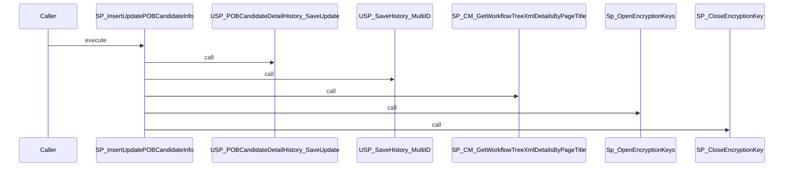
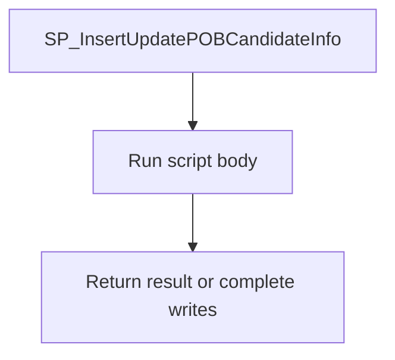

# SP_InsertUpdatePOBCandidateInfo

## What it does

Creates or updates a POB candidate initiation record, template assignment, history, and related notification rows.

## Parameters

| Name | Direction | What it is for |
|---|---|---|
| `@POBCandidateID` | in | INT |
| `@Employerid` | in | INT |
| `@CandidateId` | in | INT |
| `@SourceOfCandidate` | in | VARCHAR |
| `@CandidateName` | in | VARCHAR |
| `@ExpectedDateOfJoining` | in | DATETIME |
| `@EmailID` | in | VARCHAR |
| `@TillValidDate` | in | DATETIME |
| `@AuthenticationID` | in | INT |
| `@AuthenticationValue` | in | VARCHAR |
| `@TemplateID` | in | INT |
| `@LoginUserID` | in | INT |
| `@IsActive` | in | BIT |
| `@Comment` | in | VARCHAR |

## Call sequence

## Callers

Application callers include Core API `preOnBoardingDAL` methods used by **Employee Management → Pre-Onboarding Candidate** (`PreOnboardCandidate.aspx`). Search HRMS `STOREPROCEDURE/` and `FUNCTIONS/` for additional `EXEC`/`dbo.` callers when extending this page.

## Nested

| Object | Kind | When | Page |
|---|---|---|---|
| `USP_POBCandidateDetailHistory_SaveUpdate` | procedure | always when reached | [USP_POBCandidateDetailHistory_SaveUpdate](/docs/database/hrms/USP_POBCandidateDetailHistory_SaveUpdate) |
| `USP_SaveHistory_MultiID` | procedure | always when reached | [USP_SaveHistory_MultiID](/docs/database/hrms/USP_SaveHistory_MultiID) |
| `SP_CM_GetWorkflowTreeXmlDetailsByPageTitle` | procedure | always when reached | [SP_CM_GetWorkflowTreeXmlDetailsByPageTitle](/docs/database/hrms/SP_CM_GetWorkflowTreeXmlDetailsByPageTitle) |
| `Sp_OpenEncryptionKeys` | procedure | always when reached | [Sp_OpenEncryptionKeys](/docs/database/hrms/Sp_OpenEncryptionKeys) |
| `SP_CloseEncryptionKey` | procedure | always when reached | [SP_CloseEncryptionKey](/docs/database/hrms/SP_CloseEncryptionKey) |

## Steps

From `HRMS-DATABASE/HRMS/STOREPROCEDURE/SP_InsertUpdatePOBCandidateInfo.sql`:

1. Executes `USP_POBCandidateDetailHistory_SaveUpdate`.
2. Executes `USP_SaveHistory_MultiID`.
3. Executes `SP_CM_GetWorkflowTreeXmlDetailsByPageTitle`.
4. Executes `Sp_OpenEncryptionKeys`.
5. Executes `SP_CloseEncryptionKey`.

## Tables

| Table | Read or write |
|---|---|
| `dbo.POBCandidateAuthenticationType` | read |
| `dbo.POBCandidate` | write |
| `dbo.POBCandidateTemplate` | write |
| `dbo.TRRSCandidate` | write |
| `dbo.TEmailNotification` | write |
| `dbo.Tcandidatesource` | read |
| `dbo.POBCandidateLogin` | write |
| `dbo.POBCandidateLoginHistory` | write |

## Flow

