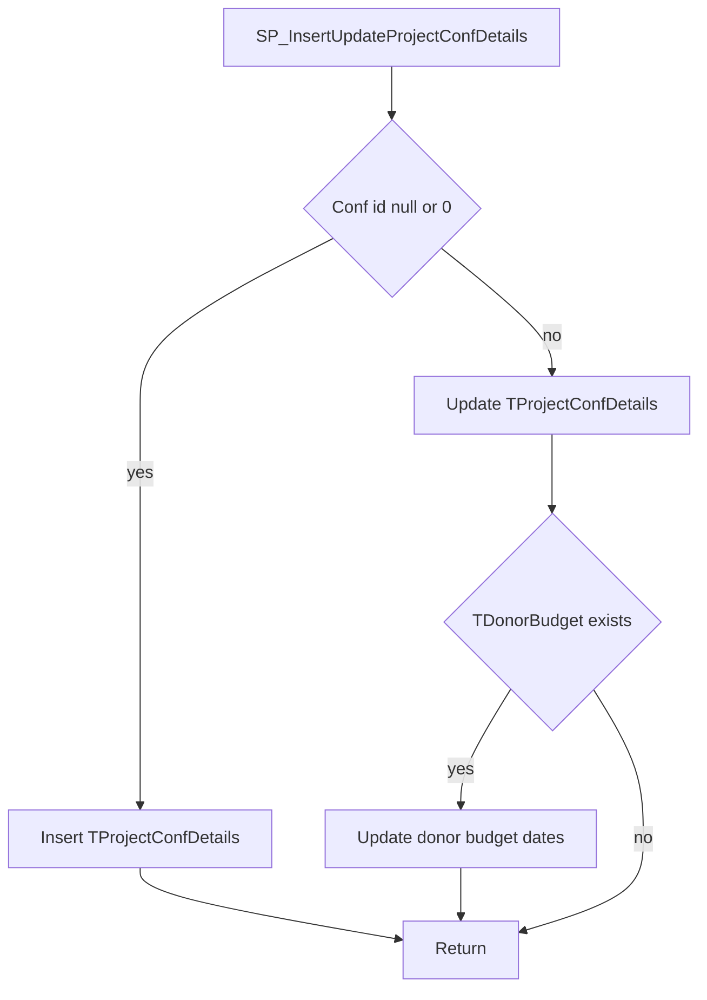

# SP_InsertUpdateProjectConfDetails

## What it does

Inserts or updates `TProjectConfDetails` for a project lookup (code, start/end dates, active flag, work location, site allowance, amount type). When updating, if a `TDonorBudget` row exists for the same project and employer, it mirrors the project start/end dates there.

## Parameters

| Name | Direction | What it is for |
|---|---|---|
| `@lProjectConfDetailsID` | in | Existing conf id; null/0 means insert |
| `@lEmployerID` | in | Employer |
| `@lLookupID` | in | Project id / lookup id |
| `@lProjectCode` | in | Project code |
| `@lStartDate` | in | Start date |
| `@lEndDate` | in | End date |
| `@lIsActive` | in | Active flag |
| `@lLoginUserID` | in | Actor |
| `@lWorkLocationID` | in | Work location |
| `@lSiteAllowanceAmount` | in | Site allowance amount |
| `@AmountType` | in | Allowance amount type |

## Call sequence

Calls no other procedures or functions.

## Callers

Procedures and functions that call this object.

| Object | Kind | Page |
|---|---|---|
| `uspProcessProjectRASdata` | procedure | No page yet |

Application caller: RA WebAPI `InsertUpdateProjectConfDetails` after a project reference save.

## Nested

Calls no other procedures or functions.

## Steps

1. Script is `HRMS-DATABASE/HRMS/STOREPROCEDURE/SP_InsertUpdateProjectConfDetails.sql`.
2. If `@lProjectConfDetailsID` is null/0, insert into `TProjectConfDetails`.
3. If `@lProjectConfDetailsID > 0`, update that row.
4. On update, when `TDonorBudget` exists for the project/employer, update its project start/end dates.

## Tables

| Table | Read or write |
|---|---|
| `dbo.TProjectConfDetails` | write |
| `dbo.TDonorBudget` | read and write |

## Flow

