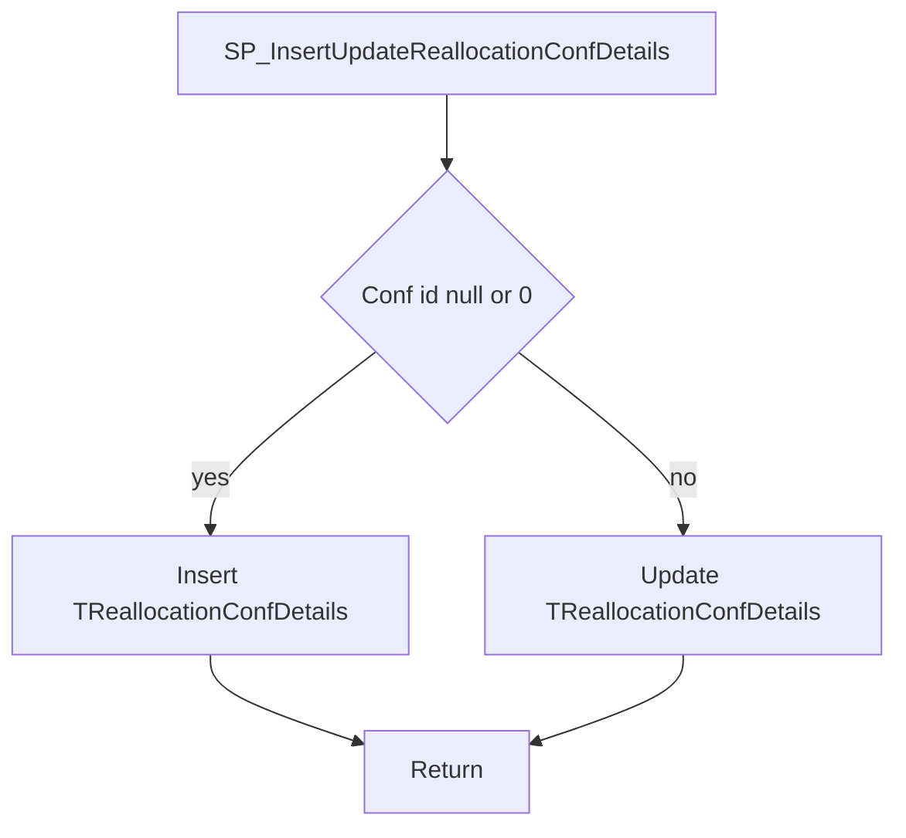

# SP_InsertUpdateReallocationConfDetails

## What it does

Inserts or updates `TReallocationConfDetails` for the reallocation-configuration lookup (`LookupParentId` 21000 on the Reference Master Setup screen): revocation day, beyond-allocation percent, and whether reallocation past end date is allowed.

## Parameters

| Name | Direction | What it is for |
|---|---|---|
| `@lReallocationConfDetailsID` | in | Existing conf id; null/0 means insert |
| `@lEmployerID` | in | Employer |
| `@lLookupID` | in | Linked lookup id |
| `@lRevocationDay` | in | Revocation day value |
| `@lAllowReallocationForPassedEndDate` | in | Allow past end-date flag |
| `@lBeyondAllocationsPercent` | in | Beyond-allocation percent |
| `@lCreatedBy` | in | Creator |
| `@lUpdatedBy` | in | Updater on edit |

## Call sequence

Calls no other procedures or functions.

## Callers

No other procedure or function calls this object. Application caller: RA WebAPI `InsertUpdateReallocationConfDetails`.

## Nested

Calls no other procedures or functions.

## Steps

1. Script is `HRMS-DATABASE/HRMS/STOREPROCEDURE/SP_InsertUpdateReallocationConfDetails.sql`.
2. If `@lReallocationConfDetailsID` is null/0, insert into `TReallocationConfDetails`.
3. If `@lReallocationConfDetailsID > 0`, update that row including `UpdatedBy` / `UpdatedDate`.

## Tables

| Table | Read or write |
|---|---|
| `dbo.TReallocationConfDetails` | write |

## Flow

