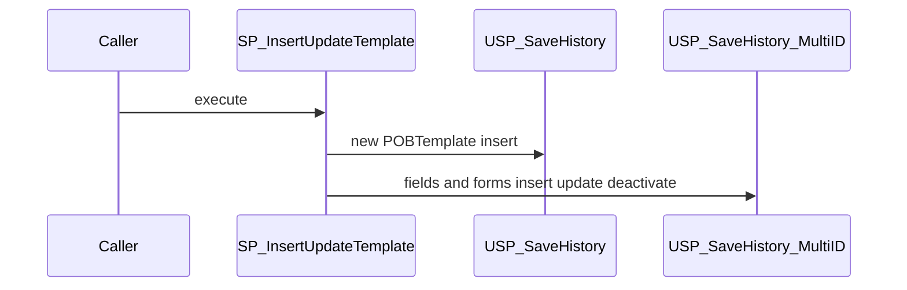
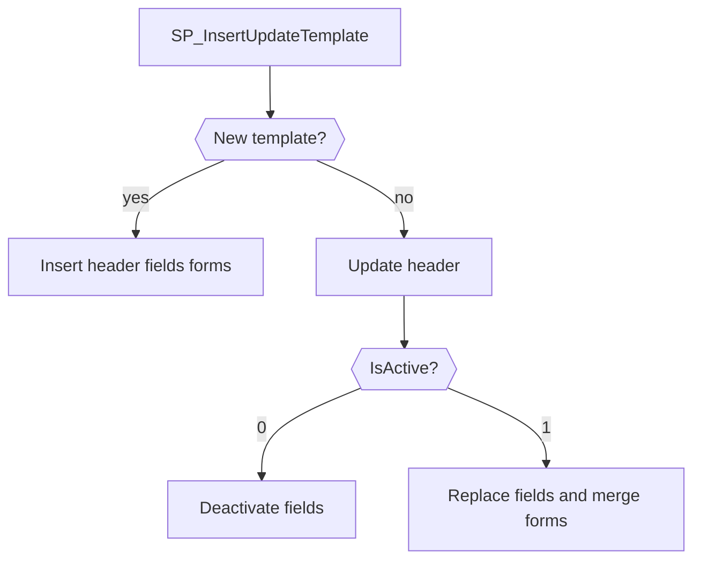

# SP_InsertUpdateTemplate

## What it does

Creates or updates a pre-onboarding template, its selected fields, and its template forms. Soft-deactivation sets `IsActive` on the header and related field rows. History is written through `USP_SaveHistory` for a new header and through `USP_SaveHistory_MultiID` for multi-row field and form changes.

## Parameters

| Name | Direction | What it is for |
|---|---|---|
| `@TemplateID` | in | Existing template id, or 0 or null to create |
| `@EmployerID` | in | Employer |
| `@TemplateName` | in | Template name |
| `@IsActive` | in | Active flag; 0 soft-deletes |
| `@LoginUserID` | in | Actor for create or modify |
| `@UDTPOBTemplateFields` | in | Selected field rows |
| `@TemplateFormList` | in | Template form file rows |
| `@CountryID` | in | Country on create |
| `@TCategoryID` | in | Template category |

## Call sequence

## Callers

No other procedure or function calls this object.

## Nested

| Object | Kind | When | Page |
|---|---|---|---|
| `USP_SaveHistory` | procedure | after inserting a new `POBTemplate` | No page yet - script not in STOREPROCEDURE |
| `USP_SaveHistory_MultiID` | procedure | after field or form inserts, updates, or deactivations | [USP_SaveHistory_MultiID](/docs/database/hrms/USP_SaveHistory_MultiID) |

## Steps

1. When `@TemplateID` is null or 0, insert `POBTemplate`, call `USP_SaveHistory`, insert field rows from the TVP, merge form rows, and write multi-id history.
2. When `@TemplateID` is greater than 0, update the header and write multi-id history.
3. When updating with `@IsActive` 0, deactivate existing field rows and write history.
4. When updating with `@IsActive` 1, deactivate prior field rows, insert the new TVP field set, and merge forms with history for insert and update actions.

## Tables

| Table | Read or write |
|---|---|
| `POBTemplate` | write |
| `POBTemplateFields` | write |
| `POBTemplateForms` | write |
| History tables named in the nested calls | write |

## Flow

