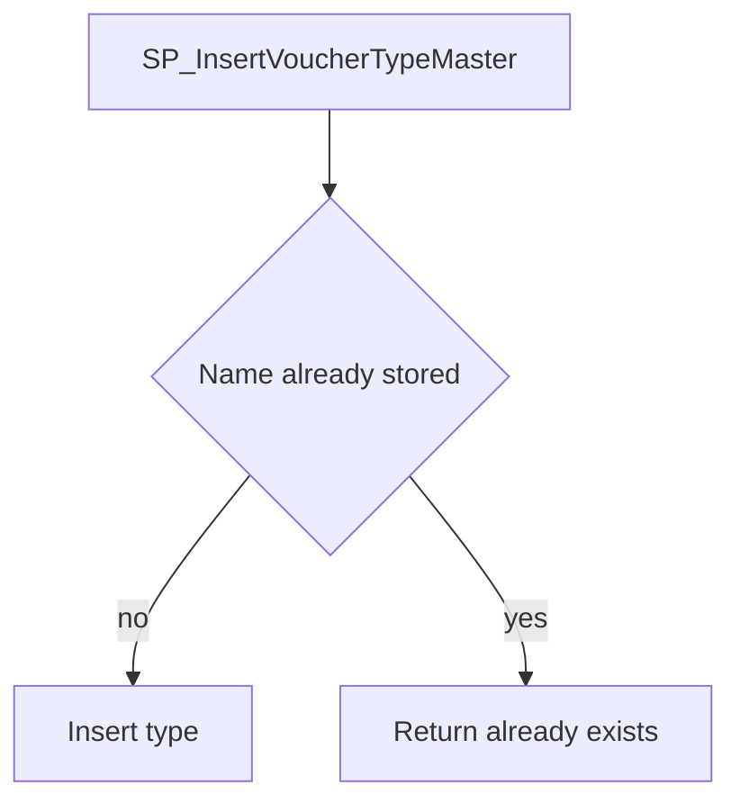

# SP_InsertVoucherTypeMaster

## What it does

Inserts a voucher type for an employer when that name is not already stored for the employer. Returns an error code and a message instead of raising an error.

## Parameters

| Name | Direction | What it is for |
|---|---|---|
| `@Name` | in | Type name |
| `@EmployerID` | in | Employer |
| `@CreatedBy` | in | Employee who created the type |
| `@IsActive` | in | Y or N |
| `@VoucherAmount` | in | Comma-separated amounts |
| `@MaxAmount` | in | Optional per-employee monthly cap |

## Call sequence

Calls no other procedures or functions.

## Callers

No other procedure or function calls this object.

## Nested

Calls no other procedures or functions.

## Steps

1. If `TvoucherTypeMaster` has no row with the same name and employer, insert the type and return error code 0 (`SP_InsertVoucherTypeMaster.sql`).
2. Otherwise return error code 1 and the message that the type already exists.

## Tables

| Table | Read or write |
|---|---|
| `dbo.TvoucherTypeMaster` | read and write |

## Flow

