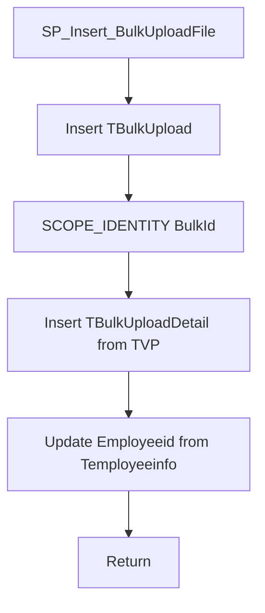

# SP_Insert_BulkUploadFile

## What it does

Inserts one `TBulkUpload` batch for an employer and category, then inserts one `TBulkUploadDetail` row per TVP `BulkUploadType` line. After the detail insert it sets `Employeeid` from the first matching `Temployeeinfo` row for that employment number and employer. Callers typically pass `Status` `Pending` so a later scheduler can process the zip.

## Parameters

| Name | Direction | What it is for |
|---|---|---|
| `@EmployerId` | in | Employer for the batch and for employee-number lookup |
| `@CategoryId` | in | Attachment category written to `TBulkUpload.CategoryId` |
| `@Status` | in | Batch status string (page uses `Pending`) |
| `@Comments` | in | Optional comments on the batch |
| `@FileName` | in | Excel file name stored on the batch |
| `@DirectoryPath` | in | Folder path where the zip was persisted |
| `@UploadedBy` | in | Uploader employee id on master and detail rows |
| `@ZipFileName` | in | Optional zip file name on the batch |
| `@BulkDetails` | in | `BulkUploadType` TVP (`EmploymentNumber`, `EmpName`, `DisplayName`) |

## Call sequence

Calls no other procedures or functions.

## Callers

No other procedure or function calls this object. `EmployeeDal.InsertEmployeeDocumentBulkUpload` executes it from Bulk Document Import (`DocumentBulkImport.aspx.cs`).

## Nested

Calls no other procedures or functions.

## Steps

1. In `HRMS-DATABASE/HRMS/STOREPROCEDURE/SP_Insert_BulkUploadFile.sql`, insert `TBulkUpload` with employer, category, status, comments, file name, directory path, `GETDATE()` upload date, uploader, `IsDeleted` `N`, and zip file name.
2. Capture `SCOPE_IDENTITY()` as `@lv_BulkId`.
3. Insert `TBulkUploadDetail` rows from `@BulkDetails`, mapping `EmploymentNumber`, `EmpName` → `EmployeeName`, `DisplayName`, with current month/year and the same uploader and upload date.
4. Update those detail rows so `Employeeid` is the top `Temployeeinfo.Employeeid` matching `EmploymentNumber` and `@EmployerId`.

## Tables

| Table | Read or write |
|---|---|
| `dbo.TBulkUpload` | write |
| `dbo.TBulkUploadDetail` | write |
| `dbo.Temployeeinfo` | read |

## Flow

