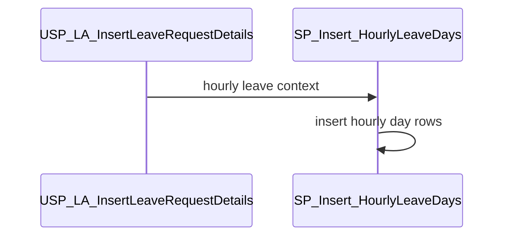
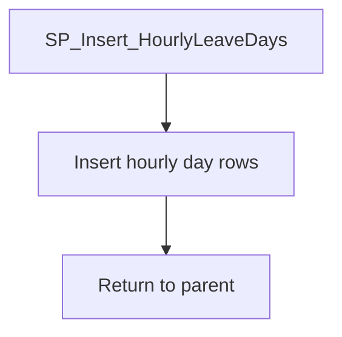

# SP_Insert_HourlyLeaveDays

## What it does

Writes hourly leave day / duration children for a leave request created by `USP_LA_InsertLeaveRequestDetails` when the leave type is hour-based (including custom duration TVP data).

## Parameters

Parent passes leave trans id, employee, leave code, date range, duration type, custom duration TVP, day count, and optional event-leave claim id (see script).

## Call sequence

## Callers

| Object | Kind | Page |
|---|---|---|
| `USP_LA_InsertLeaveRequestDetails` | procedure | [USP_LA_InsertLeaveRequestDetails](/docs/database/hrms/USP_LA_InsertLeaveRequestDetails) |

## Nested

No further procedure EXECs on the common path.

## Steps

1. Accept hourly leave context from parent insert.
2. Persist hourly / custom-duration day rows for the leave trans id.

## Tables

| Table | Read or write |
|---|---|
| Hourly leave day child table(s) | write |
| `TLeaveRequest` | read |

## Unresolved calls

None.

## Flow

