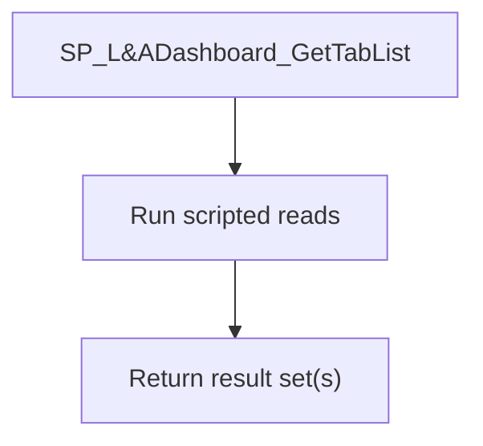

# SP_L&ADashboard_GetTabList

## What it does

Returns role-tab and user-tab rows for Leave & Attendance → L&A Dashboard (MenuId 1172): My Dashboard, Manager Dashboard, Organization Dashboard.

## Parameters

| Name | Direction | What it is for |
|---|---|---|
| `@employerId` | in | `INT` |
| `@employeeId` | in | `INT` |

## Call sequence

Calls no other procedures or functions.

## Callers

No other procedure or function calls this object. Node `leaveAttendanceManagementDashboardDAL.getTabList` executes it.

## Nested

Calls no other procedures or functions.

## Steps

1. In `HRMS-DATABASE/HRMS/STOREPROCEDURE/SP_L&ADashboard_GetTabList.sql`, accept the declared parameters and set `NOCOUNT` / read-uncommitted as scripted.
2. Run the SELECT branches shown in the script and return the result set(s).

## Tables

| Table | Read or write |
|---|---|
| `dbo.SYS` | read |
| `dbo.TUsers` | read |
| `dbo.TUserEmployee` | read |
| `dbo.TEmployee` | read |
| `dbo.TRoleTabDetails` | read |
| `dbo.TTabDetails` | read |
| `dbo.TUserTabDetails` | read |

## Flow

