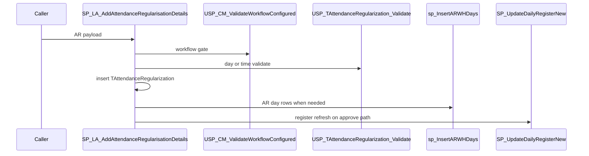
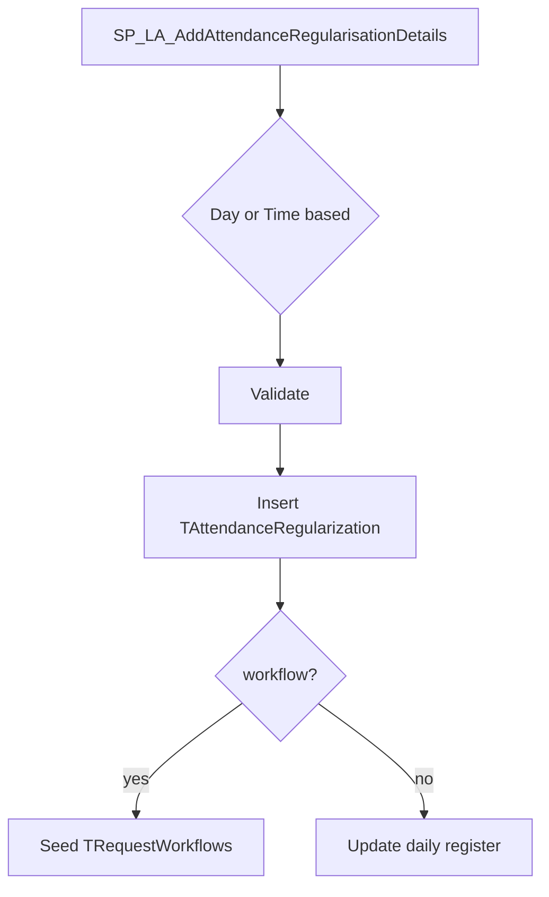

# SP_LA_AddAttendanceRegularisationDetails

## What it does

Creates an Attendance Regularization request from L&A Tasks. Validates day-based or time-based AR, inserts `TAttendanceRegularization`, seeds workflow when required, refreshes daily register on auto-approve paths, and prepares email / homepage notification data.

## Parameters

| Name | Direction | What it is for |
|---|---|---|
| `@RequestType` | in | Workflow request type |
| `@EmployeeId` | in | Employee |
| `@AttendanceCategoryId` | in | AR category |
| `@FromDate` / `@toDate` | in | Day-based range |
| `@attendanceDuration` | in | FL / FH / SH |
| `@reason` | in | Reason text |
| `@managerId` / `@workflowId` / `@approvalLevel` / `@isApprove` / `@approveStatus` | in | Routing snapshot from UI |
| `@createdBy` | in | Actor |
| `@SupportDocument` | in | Attachment name |
| `@ARStartDateTime` / `@AREndDateTime` | in | Time-based window |

## Call sequence

## Callers

| Object | Kind | Page |
|---|---|---|
| `AttendanceRegularizationDAL.AddAttendanceRegularisationDetails` | app | [L&A Tasks](/docs/guides/leave-and-attendance/l-a-tasks) |

## Nested

| Object | Kind | When | Page |
|---|---|---|---|
| `USP_CM_ValidateWorkflowConfigured` | procedure | workflow gate | [USP_CM_ValidateWorkflowConfigured](/docs/database/hrms/USP_CM_ValidateWorkflowConfigured) |
| `SP_ValidateRequest` | procedure | employee request gate | [SP_ValidateRequest](/docs/database/hrms/SP_ValidateRequest) |
| `USP_TAttendanceRegularization_Validate` | procedure | day/time validation | [USP_TAttendanceRegularization_Validate](/docs/database/hrms/USP_TAttendanceRegularization_Validate) |
| `sp_InsertARWHDays` | procedure | AR day children | [sp_InsertARWHDays](/docs/database/hrms/sp_InsertARWHDays) |
| `SP_UpdateDailyRegisterNew` | procedure | register | [SP_UpdateDailyRegisterNew](/docs/database/hrms/SP_UpdateDailyRegisterNew) |
| `SP_CM_GetDataforRequestWorkFlows` | procedure | workflow seed | [SP_CM_GetDataforRequestWorkFlows](/docs/database/hrms/SP_CM_GetDataforRequestWorkFlows) |
| `SP_CM_GetDataForEmailNotification` | procedure | email | [SP_CM_GetDataForEmailNotification](/docs/database/hrms/SP_CM_GetDataForEmailNotification) |

## Steps

1. Script is `HRMS-DATABASE/HRMS/STOREPROCEDURE/SP_LA_AddAttendanceRegularisationDetails.sql`.
2. Resolve homepage notification id and employer; read AR auto-approve customer flag.
3. Validate workflow; branch day-based vs time-based validation.
4. Insert AR header/details; on auto-approve update register; otherwise seed workflows and email.

## Tables

| Table | Read or write |
|---|---|
| `TAttendanceRegularization` | write |
| `TEmployee` / `TCustomerSettings` | read |
| `TRequestWorkflows` | write when workflow |
| `tDailyRegisterNew` | write via nested SP on approve path |

## Unresolved calls

None for the nested list above.

## Flow

