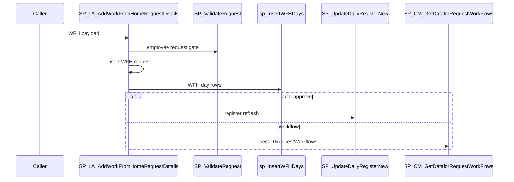
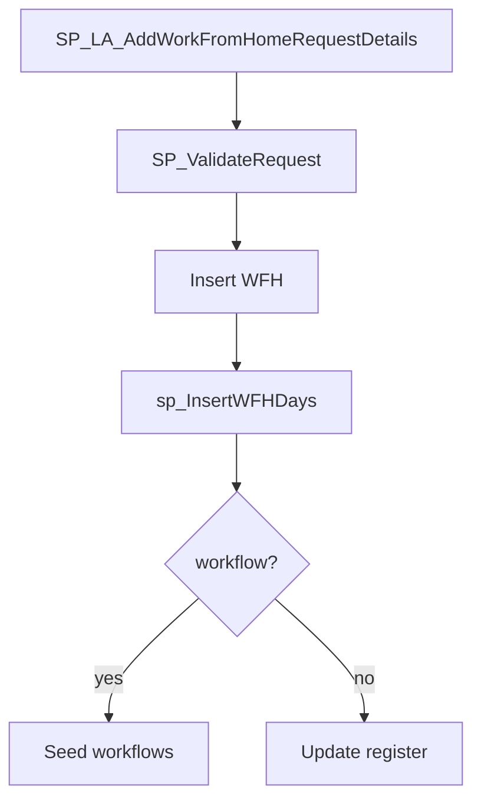

# SP_LA_AddWorkFromHomeRequestDetails

## What it does

Creates a Work From Home request from the classic L&A Tasks WFH tab. Validates the employee request, inserts the WFH artifact, materializes WFH days, refreshes daily register on auto-approve, or seeds workflow + email when approval is required.

## Parameters

| Name | Direction | What it is for |
|---|---|---|
| `@RequestType` | in | Workflow request type |
| `@employeeId` | in | Employee |
| `@Category` | in | WFH category |
| `@fromDate` / `@toDate` | in | Range |
| `@reason` | in | Reason |
| `@workflowId` | in | Workflow id from UI probe |
| `@createdBy` | in | Actor |
| `@Employerid` | in | Employer |
| `@SupportDocument` | in | Attachment |
| `@WorkFromDuration` | in | FL / FH / SH |

## Call sequence

## Callers

| Object | Kind | Page |
|---|---|---|
| `WorkFromHomeDAL.AddWFHDetails` | app | [L&A Tasks](/docs/guides/leave-and-attendance/l-a-tasks) |

## Nested

| Object | Kind | When | Page |
|---|---|---|---|
| `SP_ValidateRequest` | procedure | request gate | [SP_ValidateRequest](/docs/database/hrms/SP_ValidateRequest) |
| `sp_InsertWFHDays` | procedure | day children | [sp_InsertWFHDays](/docs/database/hrms/sp_InsertWFHDays) |
| `SP_UpdateDailyRegisterNew` | procedure | register | [SP_UpdateDailyRegisterNew](/docs/database/hrms/SP_UpdateDailyRegisterNew) |
| `SP_CM_GetDataForEmailNotification` | procedure | email | [SP_CM_GetDataForEmailNotification](/docs/database/hrms/SP_CM_GetDataForEmailNotification) |
| `SP_CM_GetDataforRequestWorkFlows` | procedure | workflow seed | [SP_CM_GetDataforRequestWorkFlows](/docs/database/hrms/SP_CM_GetDataforRequestWorkFlows) |

## Steps

1. Script is `HRMS-DATABASE/HRMS/STOREPROCEDURE/SP_LA_AddWorkFromHomeRequestDetails.sql`.
2. Derive half-day flag from `@WorkFromDuration`.
3. Validate request; insert WFH header; insert day rows.
4. Auto-approve path updates register; workflow path seeds `TRequestWorkflows` and email.

## Tables

| Table | Read or write |
|---|---|
| `TWorkFromHomeRequest` | write |
| WFH day child table(s) | write |
| `TRequestWorkflows` | write when workflow |
| `tDailyRegisterNew` | write via nested SP on approve path |

## Unresolved calls

None for the nested list above. React path may use `USP_WFH_SaveRequest` instead — outside this procedure.

## Flow

