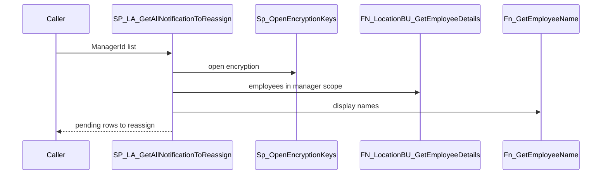
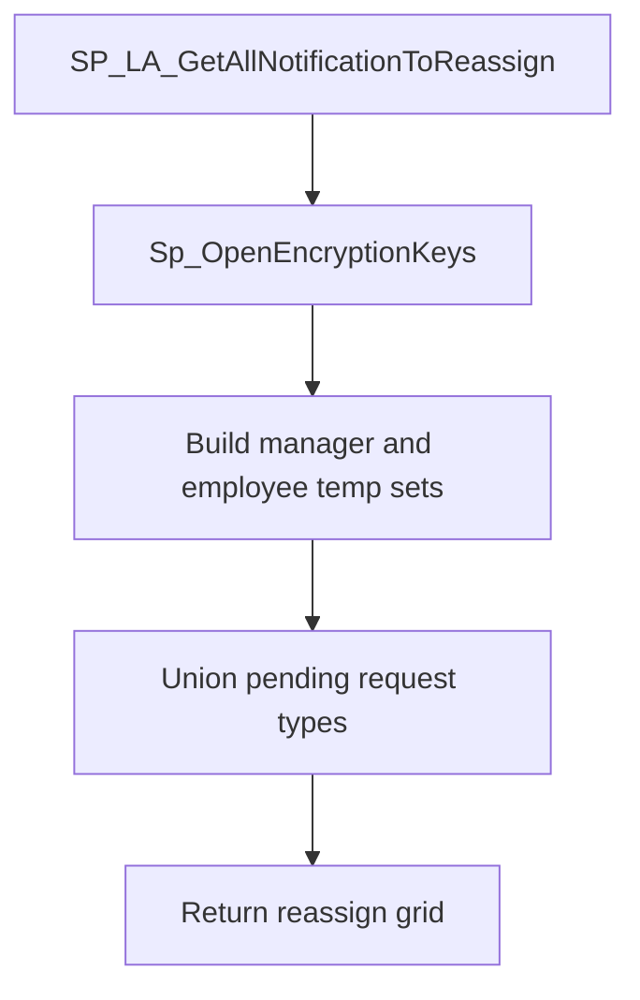

# SP_LA_GetAllNotificationToReassign

## What it does

Builds the L&A Tasks **Re-Assign Request** grid: pending leave / AR / WFH / OH / OT / related workflow rows for employees in the manager’s Location/BU access set. Opens encryption keys, expands manager ids, scopes employees via `FN_LocationBU_GetEmployeeDetails`, then unions pending request types into one result set.

## Parameters

| Name | Direction | What it is for |
|---|---|---|
| `@ManagerId` | in | Comma-separated manager employee ids |

## Call sequence

## Callers

| Object | Kind | Page |
|---|---|---|
| `ReassignDAL` (`CompensatoryOffDAL.cs`) | app | [L&A Tasks](/docs/guides/leave-and-attendance/l-a-tasks) |

## Nested

| Object | Kind | When | Page |
|---|---|---|---|
| `Sp_OpenEncryptionKeys` | procedure | encryption | [Sp_OpenEncryptionKeys](/docs/database/hrms/Sp_OpenEncryptionKeys) |
| `FN_LocationBU_GetEmployeeDetails` | function | employee scope | No page yet |
| `Fn_GetEmployeeName` | function | display names | [Fn_GetEmployeeName](/docs/database/hrms/Fn_GetEmployeeName) |

## Steps

1. Script is `HRMS-DATABASE/HRMS/STOREPROCEDURE/SP_LA_GetAllNotificationToReassign.sql`.
2. Open encryption keys; split `@ManagerId` into `#Manager`.
3. Build `#Employees` from `FN_LocationBU_GetEmployeeDetails` for each manager.
4. Select pending workflow/request rows across leave and attendance request types for those employees.

## Tables

| Table | Read or write |
|---|---|
| `TEmployee` / `TEmployeeInfo` | read |
| `TRequestWorkflows` | read |
| Leave / AR / WFH / OH / OT request tables | read |

## Unresolved calls

`FN_LocationBU_GetEmployeeDetails` page not written in this pass.

## Flow

