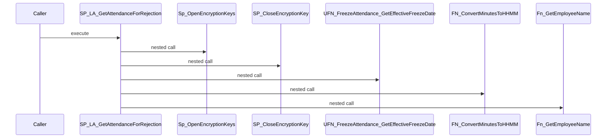
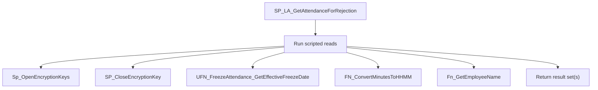

# SP_LA_GetAttendanceForRejection

## What it does

AR transaction popup on My Dashboard — attendance regularization rows for the employee.

## Parameters

| Name | Direction | What it is for |
|---|---|---|
| `@employeeId` | in | `INT` |
| `@LogedInUser` | in | `INT` |
| `@ARTransID` | in | `INT` |

## Call sequence

## Callers

No other procedure or function calls this object. Node `leaveDashboardDAL.GetARTranscations` executes it.

## Nested

| Object | Kind | When | Page |
|---|---|---|---|
| `Sp_OpenEncryptionKeys` | procedure | when reached in script | [Sp_OpenEncryptionKeys](/docs/database/hrms/Sp_OpenEncryptionKeys) |
| `SP_CloseEncryptionKey` | procedure | when reached in script | [SP_CloseEncryptionKey](/docs/database/hrms/SP_CloseEncryptionKey) |
| `UFN_FreezeAttendance_GetEffectiveFreezeDate` | function | when reached in script | No page yet |
| `FN_ConvertMinutesToHHMM` | function | when reached in script | [FN_ConvertMinutesToHHMM](/docs/database/hrms/FN_ConvertMinutesToHHMM) |
| `Fn_GetEmployeeName` | function | when reached in script | [Fn_GetEmployeeName](/docs/database/hrms/Fn_GetEmployeeName) |

## Steps

1. In `HRMS-DATABASE/HRMS/STOREPROCEDURE/SP_LA_GetAttendanceForRejection.sql`, accept the declared parameters and set `NOCOUNT` / read-uncommitted as scripted.
2. Build filter / reportee temp sets when the script calls nested helpers.
3. Aggregate leave/attendance (or tab ACL) rows and return the chart or card result set(s).

## Tables

| Table | Read or write |
|---|---|
| `dbo.TEmployeeInfo` | read |
| `dbo.TAttendanceRegularization` | read |
| `dbo.TAttendanceRegularizeCategory` | read |
| `dbo.TRequestWorkflows` | read |
| `dbo.TAttendanceOverTime_AR_Link` | read |
| `dbo.TAttendanceOverTimeRequest` | read |
| `dbo.TClaimPH_AR_Link` | read |
| `dbo.TClaimPHRequest` | read |
| `dbo.TCompOff_AR_Link` | read |
| `dbo.TCompOffRequest_LeaveDetails` | read |
| `dbo.TLeaveRequest` | read |
| `dbo.TComp_OffRequestByEmployee` | read |
| `dbo.tEmployee` | read |

## Flow

