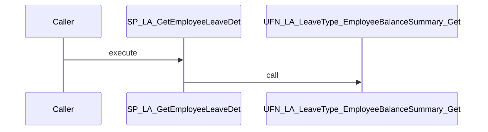
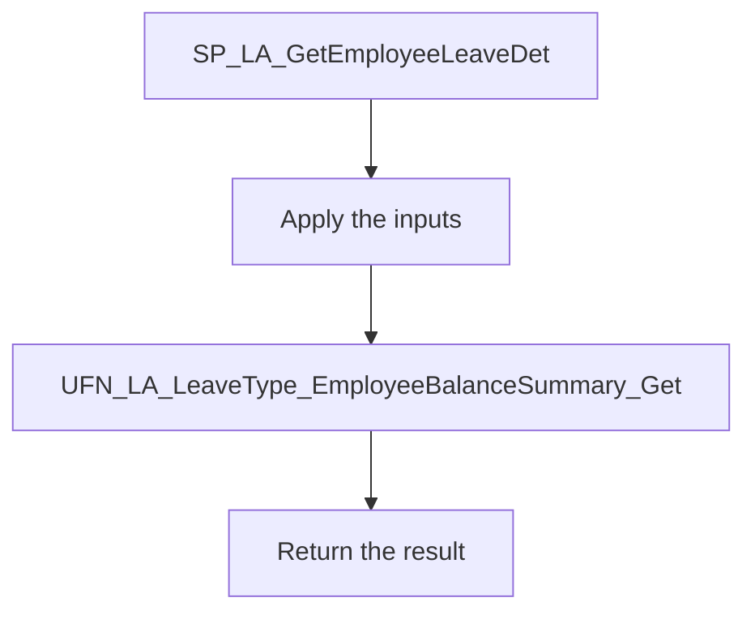

# SP_LA_GetEmployeeLeaveDet

## What it does

Returns the employee's leave plan for a date range: leave taken on those days and the current balance summary for the leave types the employee holds.

## Parameters

| Name | Direction | What it is for |
|---|---|---|
| `@EmployeeId` | in | Employee the Home screen is loading or acting for (`INT`) |
| `@StartDate` | in | Range start (`DATE`) |
| `@EndDate` | in | Range end (`DATE`) |

## Call sequence

## Callers

No other procedure or function under STOREPROCEDURE or FUNCTIONS executes this object.

## Nested

| Object | Kind | When | Page |
|---|---|---|---|
| `UFN_LA_LeaveType_EmployeeBalanceSummary_Get` | function | Called while this object runs | [UFN_LA_LeaveType_EmployeeBalanceSummary_Get](/docs/database/hrms/UFN_LA_LeaveType_EmployeeBalanceSummary_Get) |

## Steps

In `HRMS-DATABASE/HRMS/STOREPROCEDURE/SP_LA_GetEmployeeLeaveDet.sql`:

1. Returns the employee's leave plan for a date range: leave taken on those days and the current balance summary for the leave types the employee holds.

## Tables

| Table | Read or write |
|---|---|
| `temployeeinfo` | read |
| `TLeaveTypeMaster` | read |
| `TEmployee` | read |
| `TLeaveRequestDays` | read |
| `TDailyRegisterNew` | read |

## Flow

