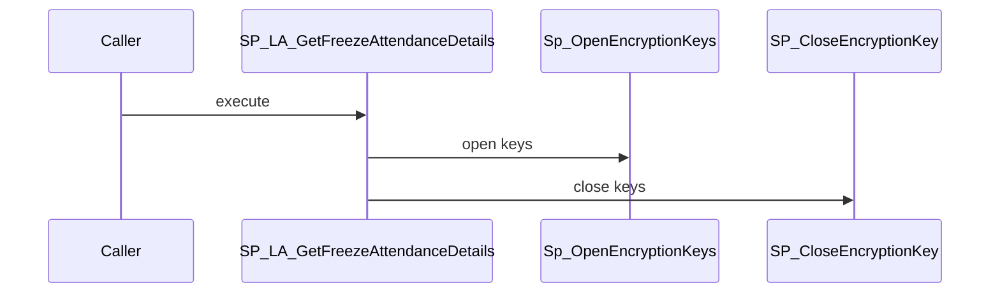
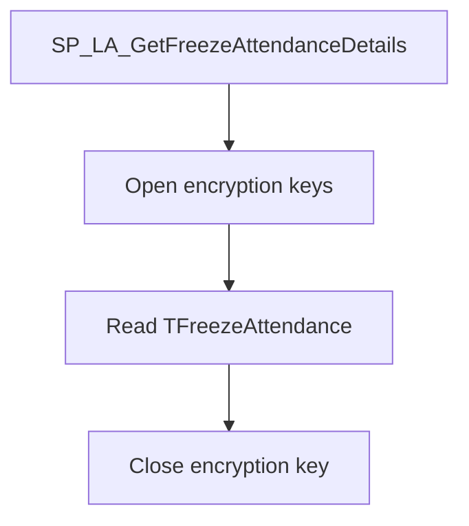

# SP_LA_GetFreezeAttendanceDetails

## What it does

Lists attendance-freeze rows for one employer. It opens the encryption keys so the creator's employment number and name can be read, selects from `TFreezeAttendance`, then closes the keys.

## Parameters

| Name | Direction | What it is for |
|---|---|---|
| `@Employerid` | in | Organisation whose freeze rows are listed |

## Call sequence

## Callers

No other procedure or function calls this object. `AttendanceRegularizationDAL.GetFreezeAttendanceDetails` calls it. Attendance Management reaches that DAL through `AttendanceRegularizationBLL.GetFreezeAttendanceDetails`.

## Nested

| Object | Kind | When | Page |
|---|---|---|---|
| `Sp_OpenEncryptionKeys` | procedure | at the start of the read | [Sp_OpenEncryptionKeys](/docs/database/hrms/Sp_OpenEncryptionKeys) |
| `SP_CloseEncryptionKey` | procedure | after the select | [SP_CloseEncryptionKey](/docs/database/hrms/SP_CloseEncryptionKey) |

## Steps

1. `EXEC Sp_OpenEncryptionKeys`.
2. Select freeze date, creator employment number, creator name, created date, comments, and applicable-to from `TFreezeAttendance` for `@Employerid`.
3. `EXEC SP_CloseEncryptionKey`.

## Tables

| Table | Read or write |
|---|---|
| `TFreezeAttendance` | read |

## Flow

