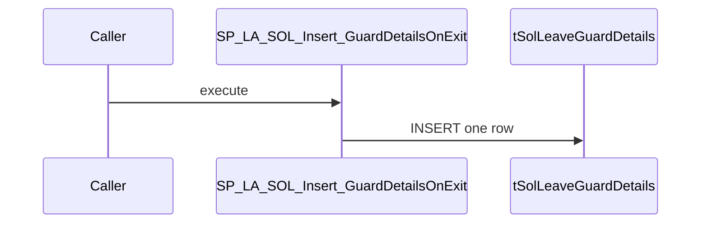
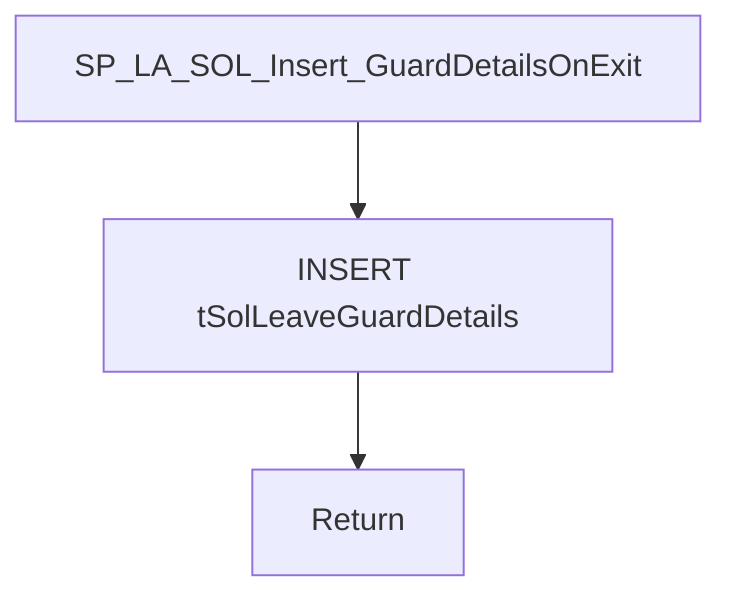

# SP_LA_SOL_Insert_GuardDetailsOnExit

## What it does

Inserts one AccessPoint guard check-out row into `tSolLeaveGuardDetails` for a SOL leave transaction. Used by Core API `POST /sol/postSOLExitData` when the guard confirms leave checkout on AccessPoint → Employee.

## Parameters

| Name | Direction | What it is for |
|---|---|---|
| `@LeaveTransId` | in | Leave transaction id being exited |
| `@EmployeeId` | in | Employee leaving on SOL |
| `@GuardID` | in | Signed-in guard employee id |
| `@GuardName` | in | Guard display name (up to 500 chars) |
| `@SOLActualOutTime` | in | Actual out timestamp (API passes `new Date()`) |
| `@CreatedBy` | in | Creator id (API passes the same value as `@GuardID`) |

## Call sequence

## Callers

| Object | Kind | Page |
|---|---|---|
| `SOLDAL.PostSOLExitData` | app | [Employee](/docs/guides/access-point/employee) |

No other procedure in `STOREPROCEDURE/` executes it.

## Nested

None.

## Steps

1. Script is `HRMS-DATABASE/HRMS/STOREPROCEDURE/SP_LA_SOL_Insert_GuardDetailsOnExit.sql`.
2. `INSERT INTO tSolLeaveGuardDetails` with `LeaveTransId`, `EmployeeId`, `GuardID`, `GuardName`, `SOLActualOutTime`, `CreatedBy`.
3. Set `Createdon` to `GETDATE()`.
4. No existence check, uniqueness check, or leave-status validation inside the procedure.

## Tables

| Table | Read or write |
|---|---|
| `dbo.tSolLeaveGuardDetails` | write |

## Unresolved calls

None.

## Flow

