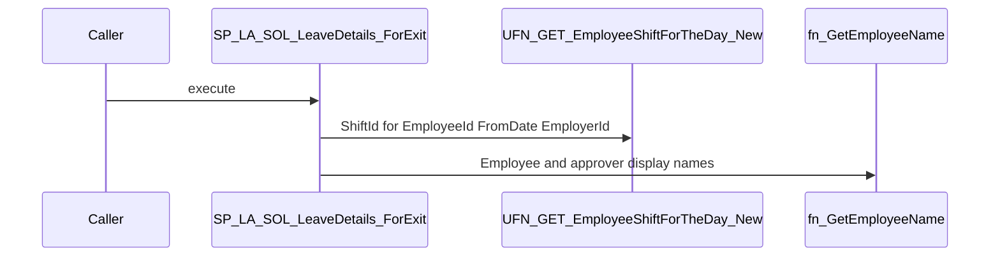
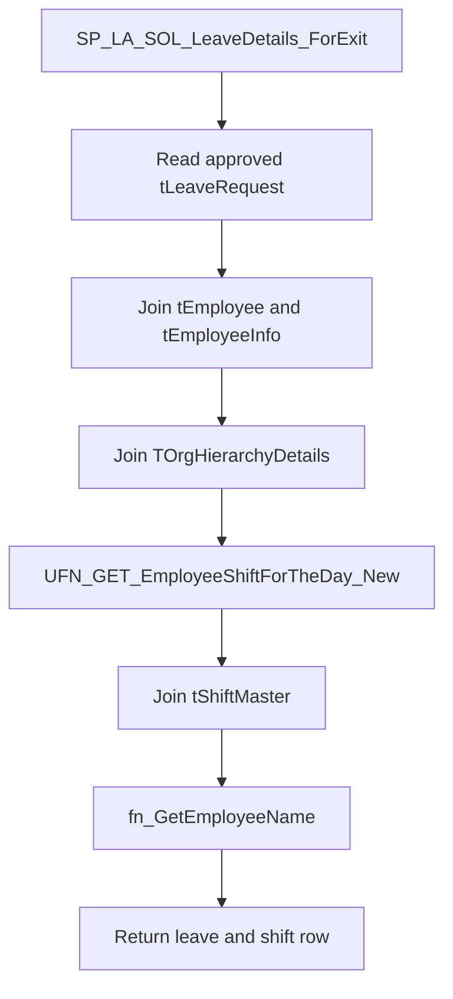

# SP_LA_SOL_LeaveDetails_ForExit

## What it does

Returns one approved short-on-leave (SOL) leave row for AccessPoint employee exit verification. Joins the leave request to employee, employment number, business unit, last-updater as approver, and active shift master times for the leave FromDate. Used by Core API `GET /sol/getEmployeeLeaveDetails` after a guard scans a SOL QR.

## Parameters

| Name | Direction | What it is for |
|---|---|---|
| `@LeaveTransId` | in | `tLeaveRequest.TransId` from QR `solId` |
| `@EmployeeId` | in | Employee on the leave |
| `@EmployerId` | in | Employer scope for that employee |

## Call sequence

## Callers

| Object | Kind | Page |
|---|---|---|
| `SOLDAL.GetEmployeeLeaveDetails` | app | [Employee](/docs/guides/access-point/employee) |

No other procedure in `STOREPROCEDURE/` executes it.

## Nested

| Object | Kind | Role |
|---|---|---|
| `UFN_GET_EmployeeShiftForTheDay_New` | function | Resolve shift id for leave FromDate |
| `fn_GetEmployeeName` | function | Employee and approver (`Lastupdateby`) display names |

## Steps

1. Script is `HRMS-DATABASE/HRMS/STOREPROCEDURE/SP_LA_SOL_LeaveDetails_ForExit.sql`.
2. `SET TRANSACTION ISOLATION LEVEL READ UNCOMMITTED`.
3. `SELECT` from `tLeaveRequest` inner-joined to `tEmployee` where `TransId = @LeaveTransId` and `LeaveStatus = 'Approved'`.
4. Join `tEmployeeInfo` for employment number and business unit (`TOrgHierarchyDetails`).
5. Join `tShiftMaster` on `ShiftId = dbo.UFN_GET_EmployeeShiftForTheDay_New(...)` for the leave FromDate, same employer, active shift.
6. Join `tEmployeeInfo` again for `Lastupdateby` as approved-by employment number; resolve names with `fn_GetEmployeeName`.
7. Filter `TE.EmployeeId = @EmployeeId` and `TE.EmployerId = @EmployerId`.
8. Return employee, leave, reason, approver, and shift start/end as FromDate plus shift start/end times; `Noofdays` aliased as `LeaveDurationInMinutes`.

## Tables

| Table | Read or write |
|---|---|
| `dbo.tLeaveRequest` | read |
| `dbo.tEmployee` | read |
| `dbo.tEmployeeInfo` | read |
| `dbo.TOrgHierarchyDetails` | read |
| `dbo.tShiftMaster` | read |

## Unresolved calls

None.

## Flow

