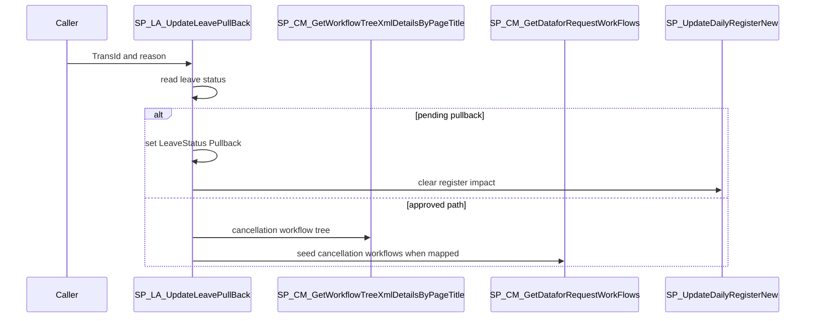
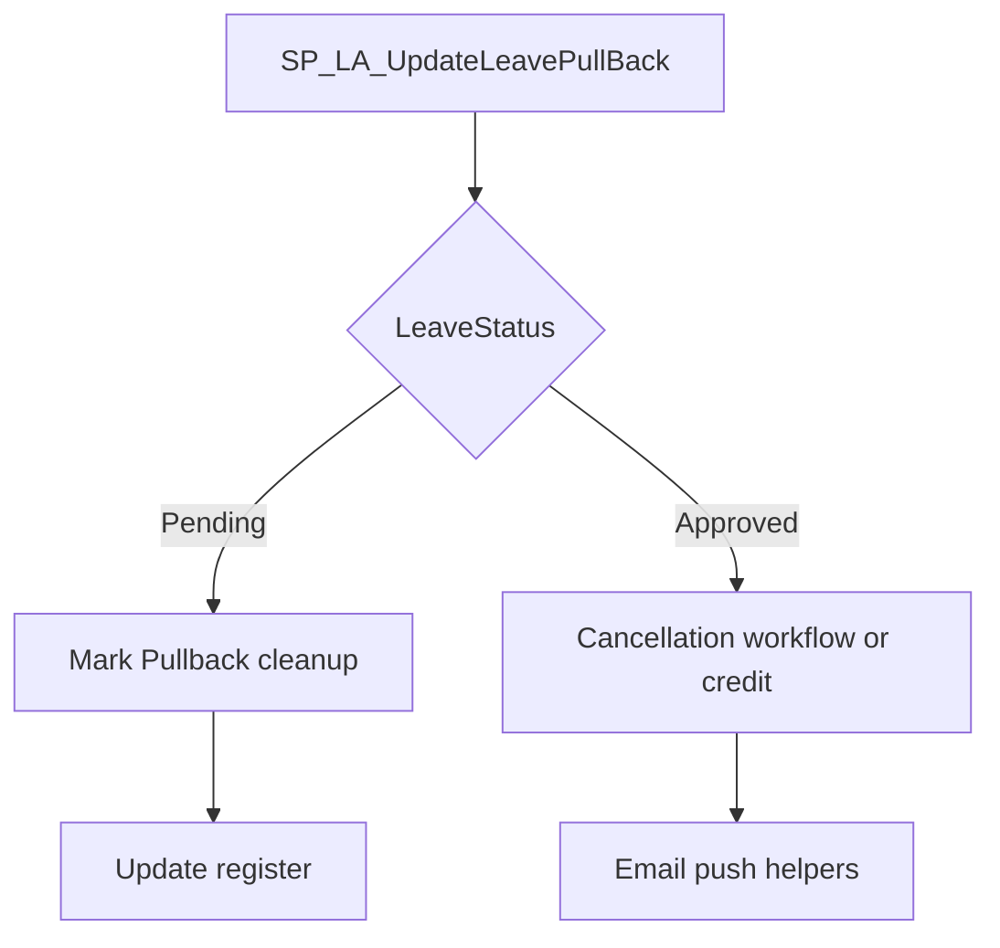

# SP_LA_UpdateLeavePullBack

## What it does

Handles leave pullback from L&A Tasks. For still-pending leave, marks the request pulled back and cleans related workflow / register / notification state. For already-approved leave, can open a LeaveCancellation-style workflow path, restore balance pieces, and refresh the daily register.

## Parameters

| Name | Direction | What it is for |
|---|---|---|
| `@TransId` | in | `TLeaveRequest.TransId` |
| `@EmployeeID` | in | Leave owner |
| `@AppliedBy` | in | Actor performing pullback |
| `@PullbackReason` | in | Reason text |

## Call sequence

## Callers

| Object | Kind | Page |
|---|---|---|
| `LeaveDAL.UpdateLeavePullBack` | app | [L&A Tasks](/docs/guides/leave-and-attendance/l-a-tasks) |

## Nested

| Object | Kind | When | Page |
|---|---|---|---|
| `SP_CM_GetWorkflowTreeXmlDetailsByPageTitle` | procedure | cancellation / pullback workflow | [SP_CM_GetWorkflowTreeXmlDetailsByPageTitle](/docs/database/hrms/SP_CM_GetWorkflowTreeXmlDetailsByPageTitle) |
| `SP_CM_GetDataforRequestWorkFlows` | procedure | seed cancellation routing | [SP_CM_GetDataforRequestWorkFlows](/docs/database/hrms/SP_CM_GetDataforRequestWorkFlows) |
| `SP_CM_GetDataForEmailNotification` | procedure | email | [SP_CM_GetDataForEmailNotification](/docs/database/hrms/SP_CM_GetDataForEmailNotification) |
| `USP_Leave_PushNotification_Insert` | procedure | push | No SQL file in repo (unresolved) |
| `SP_UpdateDailyRegisterNew` | procedure | register cleanup | [SP_UpdateDailyRegisterNew](/docs/database/hrms/SP_UpdateDailyRegisterNew) |
| `USP_LA_LeaveType_GetLapseDate` | procedure | lapse recalculation branches | No page yet |

## Steps

1. Script is `HRMS-DATABASE/HRMS/STOREPROCEDURE/SP_LA_UpdateLeavePullBack.sql`.
2. Load leave / employer / module context for `@TransId`.
3. Pending branch updates status to Pullback and cleans workflow/register/notification side effects.
4. Approved branch may resolve cancellation workflow, credit balance pieces, and notify.

## Tables

| Table | Read or write |
|---|---|
| `TLeaveRequest` | read/write |
| `TRequestWorkflows` | read/write |
| `tLeaveBalance` / `TLeaveBalanceLedger` | write on approved pullback paths |
| `tDailyRegisterNew` | write via nested SP |

## Unresolved calls

`USP_LA_LeaveType_GetLapseDate` nested page not written in this pass.

## Flow

