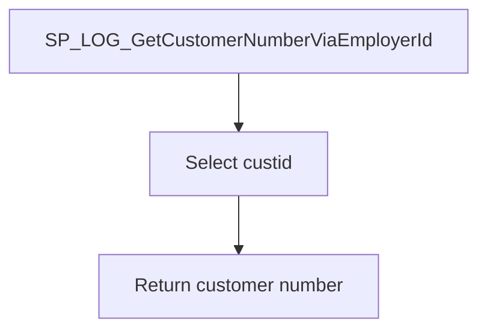

# SP_LOG_GetCustomerNumberViaEmployerId

## What it does

Returns the `custid` for one employer from `TEmployerDetails`. Welcome-email preview uses it to choose a customer-specific HTML template folder before falling back to the default template file.

## Parameters

| Name | Direction | What it is for |
|---|---|---|
| `@EmployerId` | in | Employer whose customer number is read |

## Call sequence

Calls no other procedures or functions.

## Callers

No other procedure or function calls this object. Application caller: `LoginDal.GetCustomerNumberByEmployerId` from dashboard welcome-email preview.

## Nested

Calls no other procedures or functions.

## Steps

1. Select `custid` from `TEmployerDetails` where `Employerid = @EmployerId`.

## Tables

| Table | Read or write |
|---|---|
| `dbo.TEmployerDetails` | read |

## Flow

