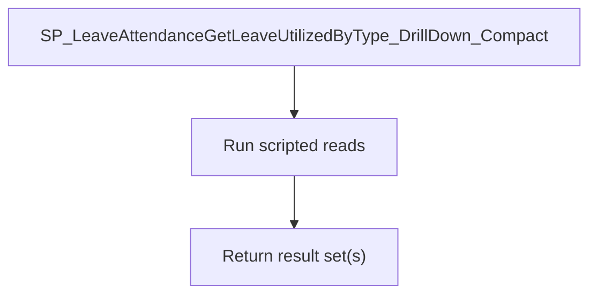

# SP_LeaveAttendanceGetLeaveUtilizedByType_DrillDown_Compact

## What it does

Employee leave utilization for one leave type code.

## Parameters

| Name | Direction | What it is for |
|---|---|---|
| — | — | No parameters declared |

## Call sequence

Calls no other procedures or functions.

## Callers

No other procedure or function calls this object. Node `leaveAttendanceManagementDashboardDAL.getLeaveUtilizedByTypeDrillDown` executes it.

## Nested

Calls no other procedures or functions.

## Steps

1. In `HRMS-DATABASE/HRMS/STOREPROCEDURE/SP_LeaveAttendanceGetLeaveUtilizedByType_DrillDown_Compact.sql`, accept the declared parameters and set `NOCOUNT` / read-uncommitted as scripted.
2. Run the SELECT branches shown in the script and return the result set(s).

## Tables

| Table | Read or write |
|---|---|
| — | No persistent tables detected in static parse |

## Flow

