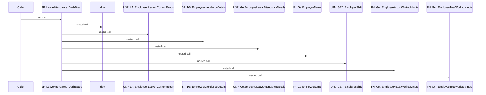
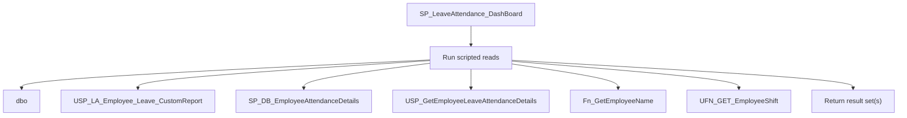

# SP_LeaveAttendance_DashBoard

## What it does

My Dashboard aggregator. Returns multiple result sets for leave summary, AR, WFH, approval ratio, leave trend, swipe info, attendance trends/summary, and yearly attendance cards for one employee and date windows.

## Parameters

| Name | Direction | What it is for |
|---|---|---|
| `@EmployeeID` | in | `INT` |
| `@CardID` | in | `INT` |
| `@MonthFromDate` | in | `DATETIME` |
| `@MonthToDate` | in | `DATETIME` |
| `@HistoryFromDate` | in | `DATETIME` |
| `@HistoryToDate` | in | `DATETIME` |
| `@CurrentFromDate` | in | `DATETIME` |
| `@CurrentToDate` | in | `DATETIME` |

## Call sequence

## Callers

No other procedure or function calls this object. Node `leaveDashboardDAL.GetLeaveAttendance` executes it.

## Nested

| Object | Kind | When | Page |
|---|---|---|---|
| `dbo` | procedure | when reached in script | No page yet |
| `USP_LA_Employee_Leave_CustomReport` | procedure | when reached in script | [USP_LA_Employee_Leave_CustomReport](/docs/database/hrms/USP_LA_Employee_Leave_CustomReport) |
| `SP_DB_EmployeeAttendanceDetails` | procedure | when reached in script | [SP_DB_EmployeeAttendanceDetails](/docs/database/hrms/SP_DB_EmployeeAttendanceDetails) |
| `USP_GetEmployeeLeaveAttendanceDetails` | procedure | when reached in script | [USP_GetEmployeeLeaveAttendanceDetails](/docs/database/hrms/USP_GetEmployeeLeaveAttendanceDetails) |
| `Fn_GetEmployeeName` | function | when reached in script | [Fn_GetEmployeeName](/docs/database/hrms/Fn_GetEmployeeName) |
| `UFN_GET_EmployeeShift` | function | when reached in script | [UFN_GET_EmployeeShift](/docs/database/hrms/UFN_GET_EmployeeShift) |
| `FN_Get_EmployeeActualWorkedMinute` | function | when reached in script | [FN_Get_EmployeeActualWorkedMinute](/docs/database/hrms/FN_Get_EmployeeActualWorkedMinute) |
| `FN_Get_EmployeeTotalWorkedMinute` | function | when reached in script | No page yet |

## Steps

1. In `HRMS-DATABASE/HRMS/STOREPROCEDURE/SP_LeaveAttendance_DashBoard.sql`, accept the declared parameters and set `NOCOUNT` / read-uncommitted as scripted.
2. Build filter / reportee temp sets when the script calls nested helpers.
3. Aggregate leave/attendance (or tab ACL) rows and return the chart or card result set(s).

## Tables

| Table | Read or write |
|---|---|
| `dbo.dbo` | read |
| `dbo.TRequestWorkflows` | read |
| `dbo.TEmployee` | read |
| `dbo.TCustomerSettings` | read |
| `dbo.TLeaveRequest` | read |
| `dbo.TLeaveRequestDays` | read |
| `dbo.TEmployeeInfo` | read |
| `dbo.tLeaveTypeMaster` | read |
| `dbo.TAttendanceRegularization` | read |
| `dbo.TAttendanceRegularizeCategory` | read |
| `dbo.TWorkFromHomeRequest` | read |
| `dbo.Tleaverequestdays` | read |
| `dbo.TAttendanceTransaction` | read |
| `dbo.TSHIFTMASTER` | read |
| `dbo.TDailyRegisterNew` | read |

## Flow

