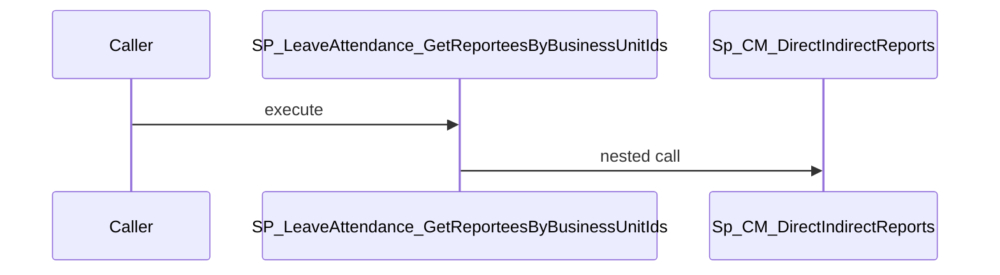
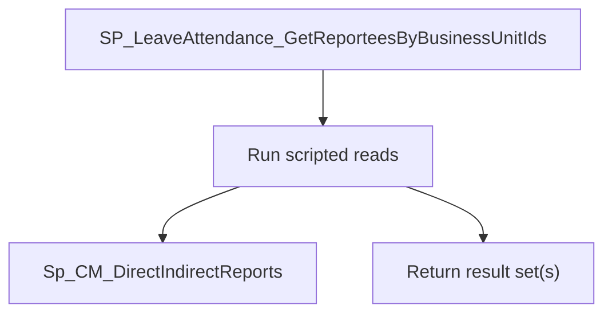

# SP_LeaveAttendance_GetReporteesByBusinessUnitIds

## What it does

Reportee list for L&A management dashboard filters, scoped by reporting type and optional BUs.

## Parameters

| Name | Direction | What it is for |
|---|---|---|
| `@EmployeeId` | in | `INT` |
| `@ReportingType` | in | `INT` |
| `@BusinessUnitIds` | in | `VARCHAR(MAX)` |
| `@IsActive` | in | `CHAR(1)` |
| `@EmployerId` | in | `--` |
| `@EmployeeId` | in | `from` |
| `@EmployeeId` | in | `AND` |
| `@BusinessUnitIds` | in | `IS` |

## Call sequence

## Callers

No other procedure or function calls this object. Node `leaveAttendanceManagementDashboardDAL.getReportees` executes it.

## Nested

| Object | Kind | When | Page |
|---|---|---|---|
| `Sp_CM_DirectIndirectReports` | procedure | when reached in script | [Sp_CM_DirectIndirectReports](/docs/database/hrms/Sp_CM_DirectIndirectReports) |

## Steps

1. In `HRMS-DATABASE/HRMS/STOREPROCEDURE/SP_LeaveAttendance_GetReporteesByBusinessUnitIds.sql`, accept the declared parameters and set `NOCOUNT` / read-uncommitted as scripted.
2. Build filter / reportee temp sets when the script calls nested helpers.
3. Aggregate leave/attendance (or tab ACL) rows and return the chart or card result set(s).

## Tables

| Table | Read or write |
|---|---|
| `dbo.STRING_SPLIT` | read |

## Flow

