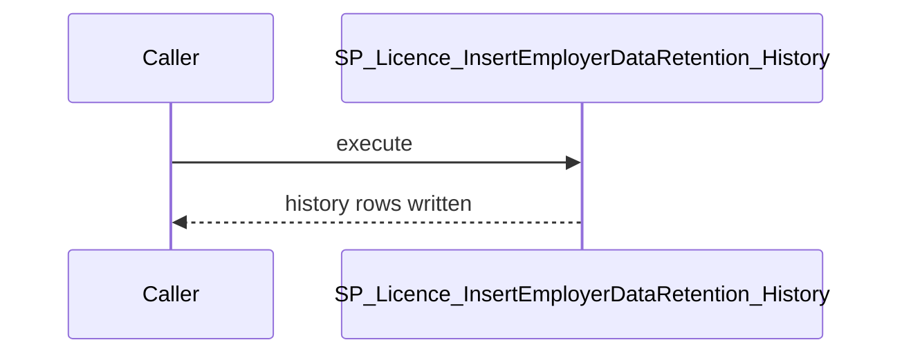
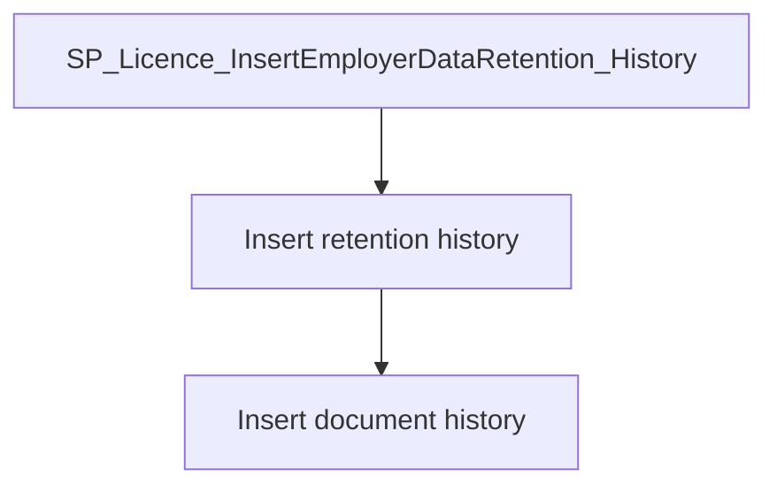

# SP_Licence_InsertEmployerDataRetention_History

## What it does

Copies the current `TEmployerDataRetention` row into `TEmployerDataRetention_History` and copies all document link rows into `TEmployerDataRetention_Documents_History` for that new history id.

## Parameters

| Name | Direction | What it is for |
|---|---|---|
| `@DataRetentionId` | in | Retention row to snapshot |
| `@UserId` | in | History actor |
| `@ActionType` | in | `I` insert or `U` update |

## Call sequence

## Callers

Called from `SP_Licence_InsertUpdateEmployerDataRetention` after insert or update.

## Nested

None.

## Steps

1. Insert history from `TEmployerDataRetention` for `@DataRetentionId`, including `@ActionType` and history audit columns.
2. Capture history identity.
3. Insert document-history rows from `TEmployerDataRetention_Documents` for that retention id.

## Tables

| Table | Read or write |
|---|---|
| `dbo.TEmployerDataRetention` | read |
| `dbo.TEmployerDataRetention_History` | write |
| `dbo.TEmployerDataRetention_Documents` | read |
| `dbo.TEmployerDataRetention_Documents_History` | write |

## Unresolved calls

None.

## Flow

