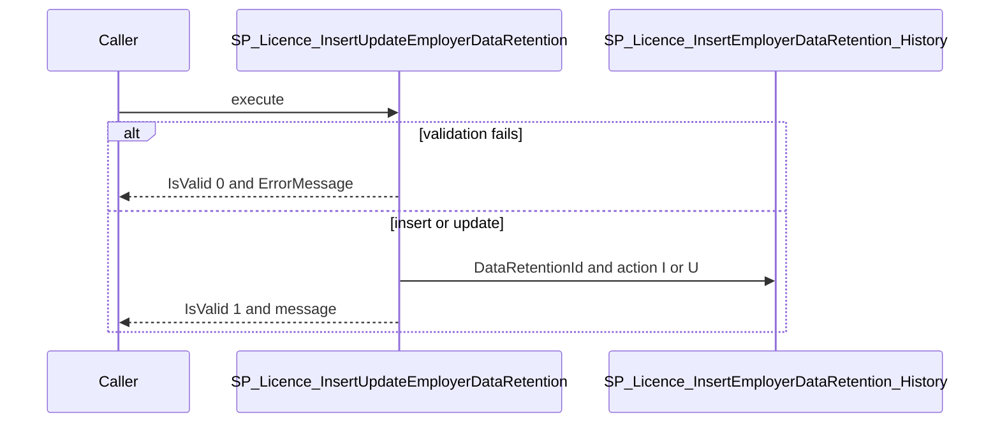
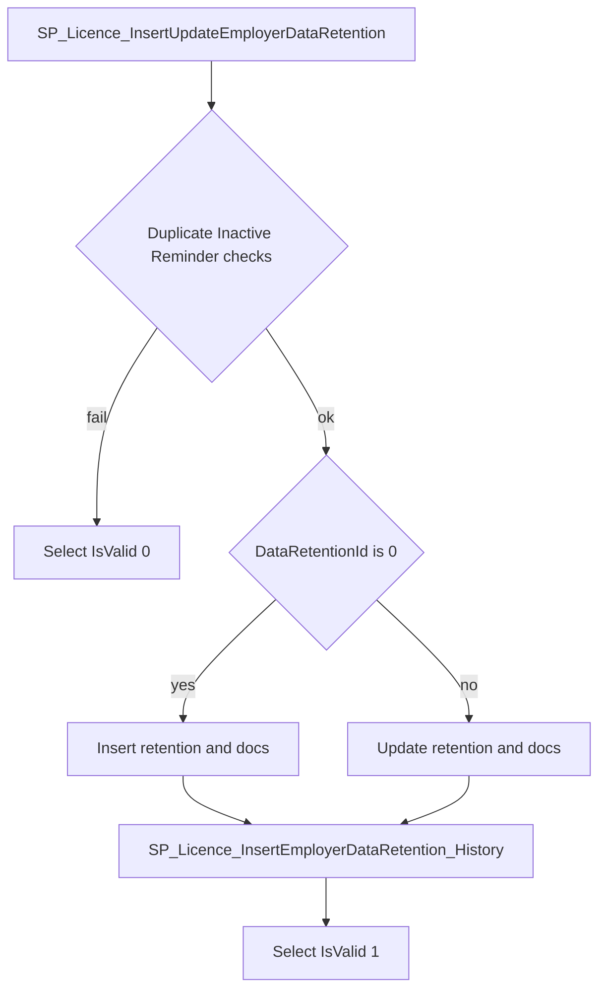

# SP_Licence_InsertUpdateEmployerDataRetention

## What it does

Inserts or updates an active `TEmployerDataRetention` row for an organisation that has an Inactive licence. Validates duplicate setup, inactive licence presence, and reminder-day bounds. Maintains linked document rows and always writes retention history.

## Parameters

| Name | Direction | What it is for |
|---|---|---|
| `@DataRetentionId` | in | Null/0 inserts; otherwise updates that row |
| `@EmployerId` | in | Organisation |
| `@DataRetentionPeriod` | in | Days after deactivation to retain data |
| `@Comments` | in | Comments |
| `@IsSendEmailReminder` | in | Whether reminder emails are enabled |
| `@SendEmailReminBeforeDays` | in | Days before retention end to start reminders |
| `@EmailReminderFrequencyDays` | in | Reminder repeat interval |
| `@DocumentID` | in | Comma-separated document ids |
| `@CreatedBy` | in | Insert actor |
| `@UpdatedBy` | in | Update actor |

## Call sequence

## Callers

No other procedure calls this object. `dashBoardDAL.InsertUpdateEmployerDataRetention` executes it from Data Retention Setup.

## Nested

| Object | Kind | When | Page |
|---|---|---|---|
| `SP_Licence_InsertEmployerDataRetention_History` | procedure | after successful insert or update | [SP_Licence_InsertEmployerDataRetention_History](/docs/database/hrms/SP_Licence_InsertEmployerDataRetention_History) |

## Steps

1. Fail if an active retention already exists for the employer on insert.
2. Require a latest Inactive `TLicence` for the employer; fail if missing.
3. Fail when reminder days exceed retention period while reminders are on.
4. Compute retention and reminder date window from deactivation date.
5. Insert path: insert retention, insert document links from CSV, history with action `I`.
6. Update path: update retention fields, sync document active flags/sequences, history with action `U`.

## Tables

| Table | Read or write |
|---|---|
| `dbo.TEmployerDataRetention` | read, write |
| `dbo.TLicence` | read |
| `dbo.TEmployerDataRetention_Documents` | write |

## Unresolved calls

None.

## Flow

