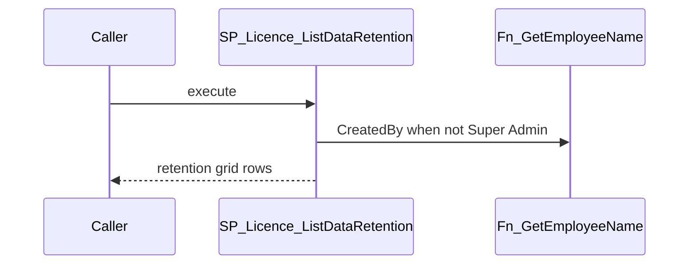
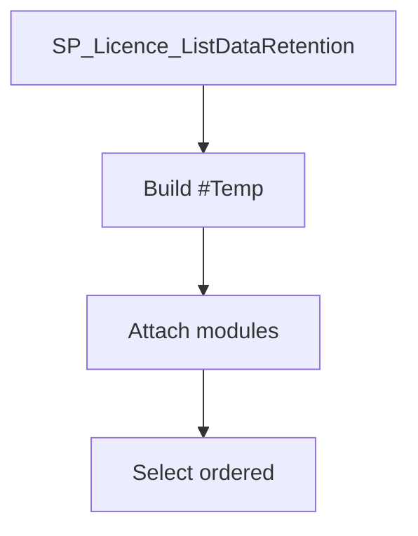

# SP_Licence_ListDataRetention

## What it does

Lists active employer data-retention setups joined to the organisation licence, with module aggregates, uploaded document file names, reminder window fields, deletion flags, and creator display name.

## Parameters

| Name | Direction | What it is for |
|---|---|---|
| `@EmployerID` | in | Optional filter to one employer |

## Call sequence

## Callers

No other procedure calls this object. `dashBoardDAL.ListDataRetention` executes it from Data Retention Setup.

## Nested

| Object | Kind | When | Page |
|---|---|---|---|
| `Fn_GetEmployeeName` | function | CreatedBy display when not `-1` | [Fn_GetEmployeeName](/docs/database/hrms/Fn_GetEmployeeName) |

## Steps

1. Build `#Temp` from `TLicence`, `TEmployerDetails`, active `TEmployerDataRetention`, active document links, and `TDocuments` file names.
2. Aggregate modules from `TEmployerModule` / `THrmsModules` and update the temp table.
3. Return rows ordered by parent organisation name.

## Tables

| Table | Read or write |
|---|---|
| `dbo.TLicence` | read |
| `dbo.TEmployerDetails` | read |
| `dbo.TEmployerDataRetention` | read |
| `dbo.TEmployerDataRetention_Documents` | read |
| `dbo.TDocuments` | read |
| `dbo.TEmployerModule` | read |
| `dbo.THrmsModules` | read |

## Unresolved calls

None.

## Flow

