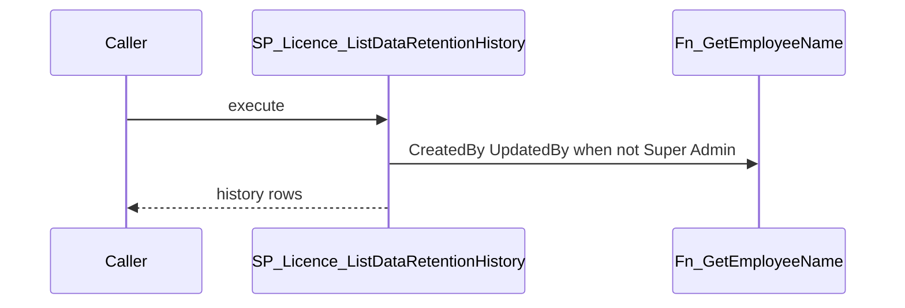
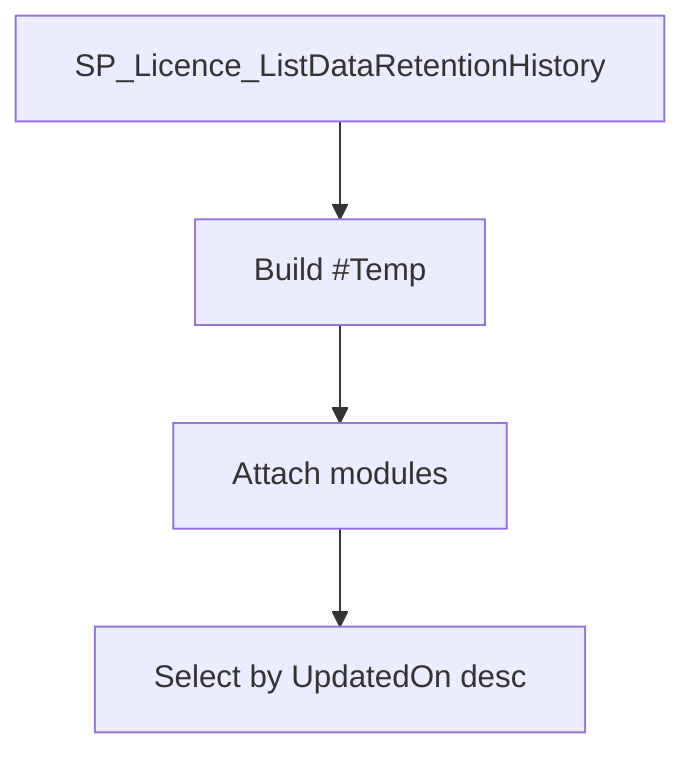

# SP_Licence_ListDataRetentionHistory

## What it does

Returns history rows for one data-retention id, joined to the organisation licence, module aggregates, document file names from history document links, and creator/updater display names.

## Parameters

| Name | Direction | What it is for |
|---|---|---|
| `@DataRetentionId` | in | Retention whose history to list |

## Call sequence

## Callers

No other procedure calls this object. `dashBoardDAL.ListDataRetentionHistory` executes it from Data Retention Setup.

## Nested

| Object | Kind | When | Page |
|---|---|---|---|
| `Fn_GetEmployeeName` | function | CreatedBy / UpdatedBy display when not `-1` | [Fn_GetEmployeeName](/docs/database/hrms/Fn_GetEmployeeName) |

## Steps

1. Build `#Temp` from licence, employer, `TEmployerDataRetention_History`, history documents, and `TDocuments` for `@DataRetentionId`.
2. Aggregate modules and update the temp table.
3. Return rows ordered by `UpdatedOn` descending.

## Tables

| Table | Read or write |
|---|---|
| `dbo.TLicence` | read |
| `dbo.TEmployerDetails` | read |
| `dbo.TEmployerDataRetention_History` | read |
| `dbo.TEmployerDataRetention_Documents_History` | read |
| `dbo.TDocuments` | read |
| `dbo.TEmployerModule` | read |
| `dbo.THrmsModules` | read |

## Unresolved calls

None.

## Flow

