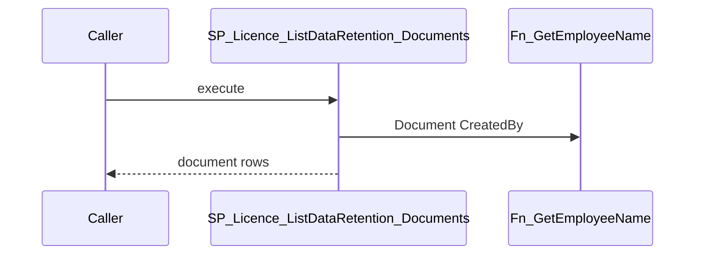
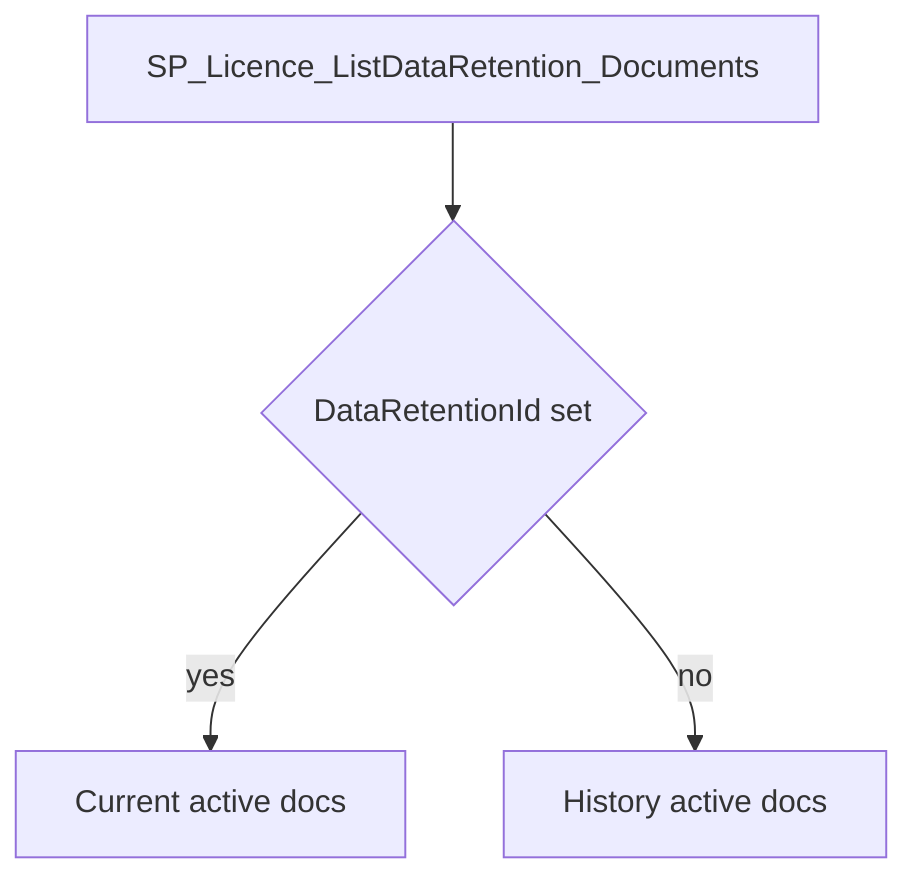

# SP_Licence_ListDataRetention_Documents

## What it does

Lists active retention documents for a current retention id, or active history documents for a retention history id, including `TDocuments` URI, file name, extension, and creator display name.

## Parameters

| Name | Direction | What it is for |
|---|---|---|
| `@DataRetentionId` | in | When set, list current `TEmployerDataRetention_Documents` |
| `@DataRetentionHistoryId` | in | When retention id is null, list history documents for this history id |

## Call sequence

## Callers

No other procedure calls this object. `dashBoardDAL.ListDataRetentionDocuments` executes it from Data Retention Setup. Note the DAL always binds both inputs; the SQL prefers `@DataRetentionId` when it is not null.

## Nested

| Object | Kind | When | Page |
|---|---|---|---|
| `Fn_GetEmployeeName` | function | document creator display | [Fn_GetEmployeeName](/docs/database/hrms/Fn_GetEmployeeName) |

## Steps

1. When `@DataRetentionId` is not null, select active current document links joined to `TDocuments`.
2. Else when `@DataRetentionHistoryId` is not null, select active history document links joined to `TDocuments`.

## Tables

| Table | Read or write |
|---|---|
| `dbo.TEmployerDataRetention_Documents` | read |
| `dbo.TEmployerDataRetention_Documents_History` | read |
| `dbo.TDocuments` | read |

## Unresolved calls

None.

## Flow

