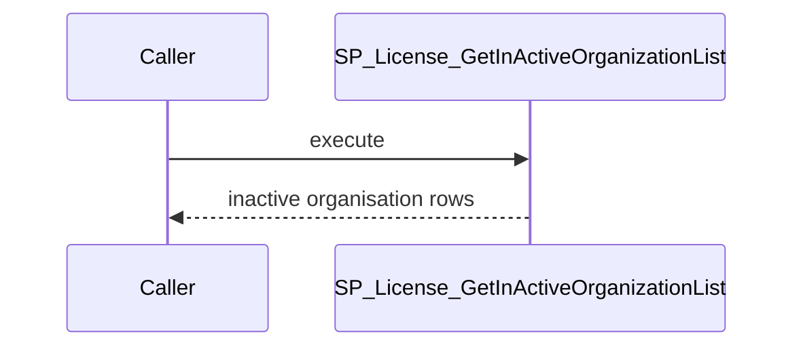
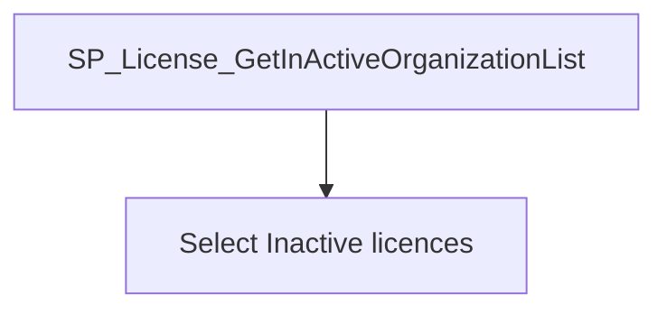

# SP_License_GetInActiveOrganizationList

## What it does

Returns distinct organisations whose `TLicence` status is `Inactive`, with display name, contact fields, deactivation timestamp (`UpdatedWhen`), and licence end period. Optional employer filter.

## Parameters

| Name | Direction | What it is for |
|---|---|---|
| `@EmployerID` | in | Optional filter to one employer |

## Call sequence

## Callers

No other procedure calls this object. `dashBoardDAL.GetInActiveOrganizationList` executes it from Data Retention Setup.

## Nested

None.

## Steps

1. Select distinct inactive `TLicence` rows joined to `TEmployerDetails`, optionally filtered by `@EmployerID`.

## Tables

| Table | Read or write |
|---|---|
| `dbo.TLicence` | read |
| `dbo.TEmployerDetails` | read |

## Unresolved calls

None.

## Flow

