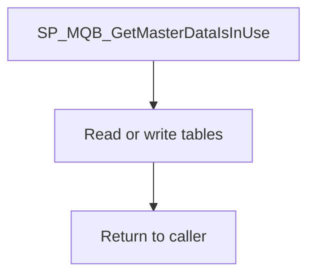

# SP_MQB_GetMasterDataIsInUse

## What it does

Reports whether a lookup value is still referenced so Setup Options can block delete.

## Parameters

| Name | Direction | What it is for |
|---|---|---|
| `@EmployerId` | in | INT |
| `@Lookup_ID` | in | INT |
| `@Lookup_Text` | in | NVARCHAR(100) |

## Call sequence

Calls no other procedures or functions.

## Callers

No other procedure or function in the Master Question Bank direct set calls this object.

Application code may call it through `masterQuestionBankDAL`.

## Nested

Calls no other procedures or functions.

## Steps

1. Inserts into the target table(s) listed under Tables.

## Tables

| Table | Read or write |
|---|---|
| `TEmployerDetails` | read |
| `TTraining` | read |
| `TMiscellaneousTrainings` | read |
| `TExternalTrainings` | read |
| `TAdhoc_Training_Request` | read |
| `TTrainingProductMapping` | read |
| `TWaiver` | read |
| `TTrainingEvaluation` | read |
| `TLOOKUPT` | read |
| `TQuestion` | read |

## Flow

