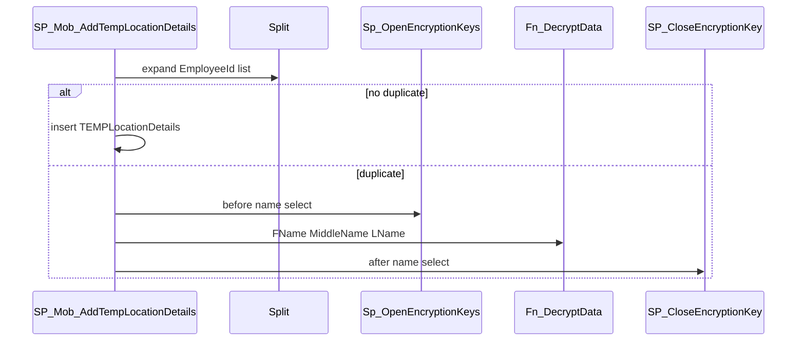
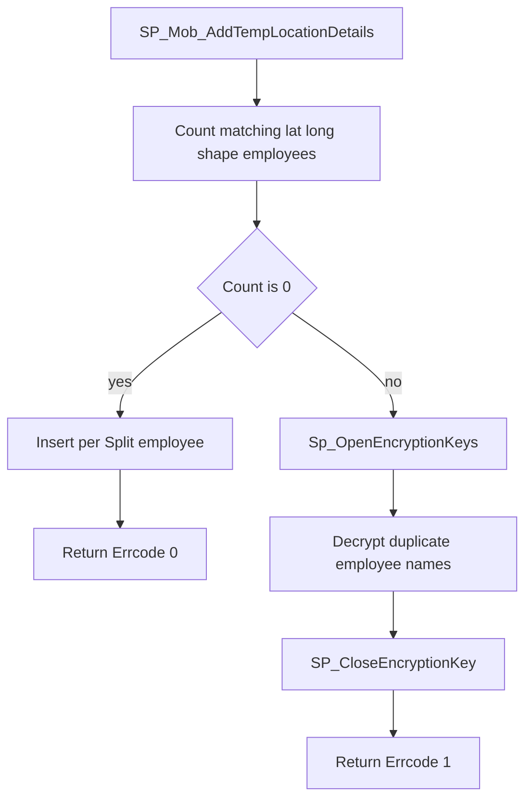

# SP_Mob_AddTempLocationDetails

## What it does

Inserts one `TEMPLocationDetails` row per employee id in the comma-separated `@EmployeeId` list when no matching lat/long (and shape/vertices) fence already exists for those employees. On duplicate it returns `Errcode = 1` with decrypted employee names instead of inserting.

## Parameters

| Name | Direction | What it is for |
|---|---|---|
| `@EmployeeId` | in | Comma-separated employee ids to assign |
| `@LocationName` | in | Fence display name |
| `@Latitude` | in | Latitude |
| `@Longitude` | in | Longitude |
| `@Radius` | in | Radius meters |
| `@address` | in | Address text |
| `@IsActive` | in | Active flag (`Y` / `N`) |
| `@Notes` | in | Notes |
| `@CreatedBy` | in | Creating employee id |
| `@EmployerId` | in | Employer id stored on each row |
| `@IsLocationTrackingOn` | in | Location tracking flag |
| `@IsFaceAuthEnabled` | in | Face auth flag |
| `@IsAutoCheckInOutEnabled` | in | Auto check-in/out flag |
| `@ShapeMode` | in | Shape mode; defaults to `circle` |
| `@VerticesJson` | in | Optional polygon vertices JSON |

## Call sequence

## Callers

No other procedure or function calls this object. Application caller: `RemoteLocationDAL.AddRemoteLocation` from Employee Remote Location Submit.

## Nested

| Object | Kind | When | Page |
|---|---|---|---|
| `Split` | function | expand `@EmployeeId` | [Split](/docs/database/hrms/Split) |
| `Sp_OpenEncryptionKeys` | procedure | duplicate name path only | [Sp_OpenEncryptionKeys](/docs/database/hrms/Sp_OpenEncryptionKeys) |
| `Fn_DecryptData` | function | duplicate name path only | [Fn_DecryptData](/docs/database/hrms/Fn_DecryptData) |
| `SP_CloseEncryptionKey` | procedure | duplicate name path only | [SP_CloseEncryptionKey](/docs/database/hrms/SP_CloseEncryptionKey) |

## Steps

1. Script is `HRMS-DATABASE/HRMS/STOREPROCEDURE/SP_Mob_AddTempLocationDetails.sql`.
2. Count existing `TEMPLocationDetails` rows matching latitude, longitude, shape mode, vertices, and employees from `Split(@EmployeeId, ',')`.
3. If count is zero, insert one row per split employee id with the supplied fence fields and `GETDATE()` created date; return `Errcode = 0`.
4. If count is greater than zero, open encryption keys, select decrypted names for employees that already have the matching fence, close encryption keys, return `Errcode = 1`.

## Tables

| Table | Read or write |
|---|---|
| `dbo.TEMPLocationDetails` | read and write |
| `dbo.TEmployee` | read (duplicate path) |

## Unresolved calls

None.

## Flow

