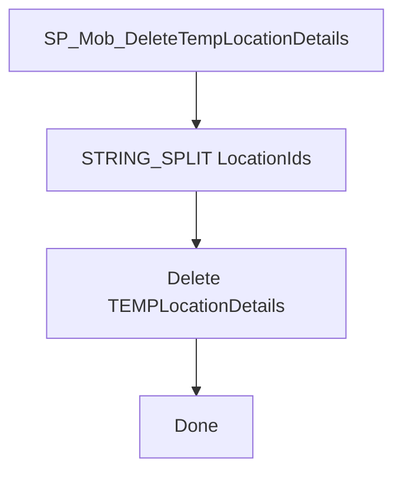

# SP_Mob_DeleteTempLocationDetails

## What it does

Deletes one or more `TEMPLocationDetails` rows whose `LocationId` values appear in the comma-separated `@LocationIds` list.

## Parameters

| Name | Direction | What it is for |
|---|---|---|
| `@LocationIds` | in | Comma-separated location ids to delete |

## Call sequence

Calls no other procedures or functions.

## Callers

No other procedure or function calls this object. Application caller: `RemoteLocationDAL.DeleteRemoteLocation` from Employee Remote Location Remove selected.

## Nested

Calls no other procedures or functions.

## Steps

1. Script is `HRMS-DATABASE/HRMS/STOREPROCEDURE/SP_Mob_DeleteTempLocationDetails.sql`.
2. `DELETE FROM TEMPLocationDetails` where `LocationId` is in `STRING_SPLIT(@LocationIds, ',')`.

## Tables

| Table | Read or write |
|---|---|
| `dbo.TEMPLocationDetails` | write |

## Unresolved calls

None.

## Flow

