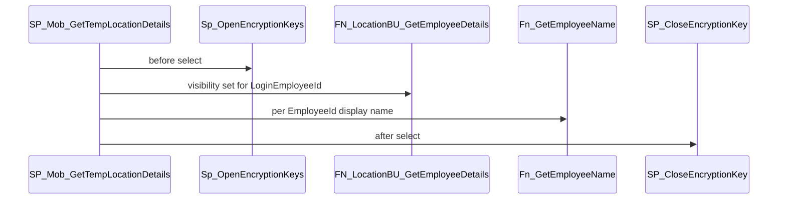
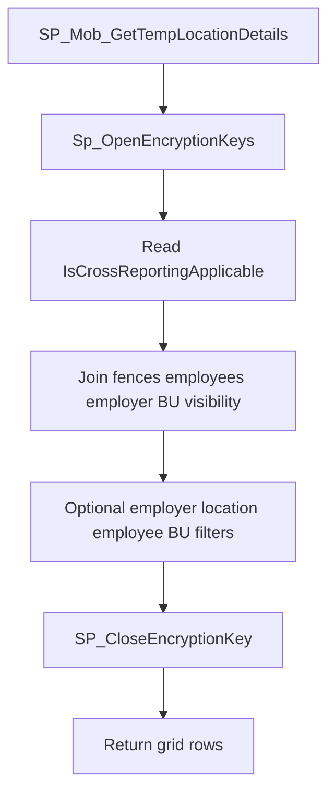

# SP_Mob_GetTempLocationDetails

## What it does

Returns distinct remote / geo-fence rows from `TEMPLocationDetails` for an employer, optionally filtered by location id, employee ids, and business units. Results are restricted to employees visible to `@LoginEmployeeId` through `FN_LocationBU_GetEmployeeDetails`. Opens and closes encryption keys around the select so `Fn_GetEmployeeName` can resolve names.

## Parameters

| Name | Direction | What it is for |
|---|---|---|
| `@EmployerId` | in | Employer scope for fence rows |
| `@LocationId` | in | Optional single location id filter |
| `@EmployeeIds` | in | Optional comma-separated employee ids |
| `@BusinessUnitID` | in | Optional comma-separated business unit ids |
| `@LoginEmployeeId` | in | Login employee used for location/BU visibility |

## Call sequence

## Callers

No other procedure or function calls this object. Application caller: `RemoteLocationDAL.GetRemoteLocationList` for Employee Remote Location grid and edit load.

## Nested

| Object | Kind | When | Page |
|---|---|---|---|
| `Sp_OpenEncryptionKeys` | procedure | start of body | [Sp_OpenEncryptionKeys](/docs/database/hrms/Sp_OpenEncryptionKeys) |
| `SP_CloseEncryptionKey` | procedure | end of body | [SP_CloseEncryptionKey](/docs/database/hrms/SP_CloseEncryptionKey) |
| `FN_LocationBU_GetEmployeeDetails` | function | join filter | [FN_LocationBU_GetEmployeeDetails](/docs/database/hrms/FN_LocationBU_GetEmployeeDetails) |
| `Fn_GetEmployeeName` | function | select list | [Fn_GetEmployeeName](/docs/database/hrms/Fn_GetEmployeeName) |

## Steps

1. Script is `HRMS-DATABASE/HRMS/STOREPROCEDURE/SP_Mob_GetTempLocationDetails.sql`.
2. `SET NOCOUNT ON` and `READ UNCOMMITTED`.
3. Execute `Sp_OpenEncryptionKeys`.
4. Read `IsCrossReportingApplicable` from `TEmployerDetails` for `@EmployerId` (value is selected into a variable; not used in the returned columns).
5. Select distinct fence columns from `TEMPLocationDetails`, joined to `TEmployeeInfo`, `TEmployerDetails`, active `TEmployee`, and `FN_LocationBU_GetEmployeeDetails(@LoginEmployeeId, NULL)`.
6. Apply optional filters on employer, `STRING_SPLIT` employee ids, location id, and business unit ids.
7. Execute `SP_CloseEncryptionKey`.

## Tables

| Table | Read or write |
|---|---|
| `dbo.TEMPLocationDetails` | read |
| `dbo.TEmployeeInfo` | read |
| `dbo.TEmployerDetails` | read |
| `dbo.TEmployee` | read |

## Unresolved calls

None.

## Flow

