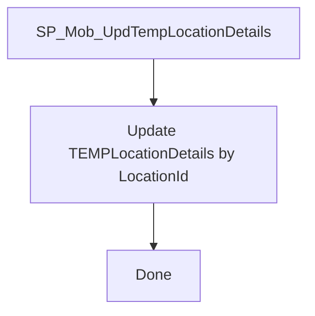

# SP_Mob_UpdTempLocationDetails

## What it does

Updates a single `TEMPLocationDetails` row identified by `@LocationId` with the supplied name, coordinates, radius, address, active flag, notes, tracking flags, shape mode, and vertices. Sets `UpdatedBy` and `UpdatedDate`.

## Parameters

| Name | Direction | What it is for |
|---|---|---|
| `@LocationId` | in | Primary key of the fence row |
| `@LocationName` | in | Fence display name |
| `@Latitude` | in | Latitude |
| `@Longitude` | in | Longitude |
| `@Radius` | in | Radius meters |
| `@address` | in | Address text |
| `@IsActive` | in | Active flag (`Y` / `N`) |
| `@Notes` | in | Notes |
| `@UpdatedBy` | in | Updating employee id |
| `@IsLocationTrackingOn` | in | Location tracking flag |
| `@IsFaceAuthEnabled` | in | Face auth flag |
| `@IsAutoCheckInOutEnabled` | in | Auto check-in/out flag |
| `@ShapeMode` | in | Shape mode; empty becomes `circle` |
| `@VerticesJson` | in | Optional polygon vertices JSON |

## Call sequence

Calls no other procedures or functions.

## Callers

No other procedure or function calls this object. Application caller: `RemoteLocationDAL.UpdateRemoteLocation` from Employee Remote Location Update.

## Nested

Calls no other procedures or functions.

## Steps

1. Script is `HRMS-DATABASE/HRMS/STOREPROCEDURE/SP_Mob_UpdTempLocationDetails.sql`.
2. `UPDATE TEMPLocationDetails` set fence columns from parameters.
3. Coalesce empty `@ShapeMode` to `circle`.
4. Restrict with `WHERE LocationId = @LocationId`.

## Tables

| Table | Read or write |
|---|---|
| `dbo.TEMPLocationDetails` | write |

## Unresolved calls

None.

## Flow

