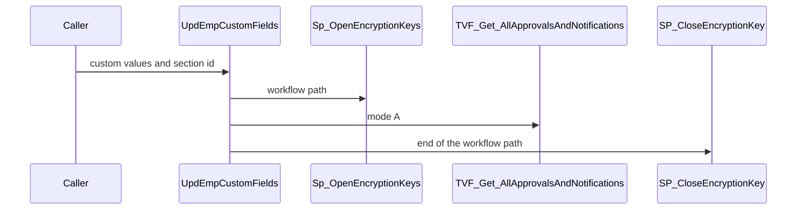
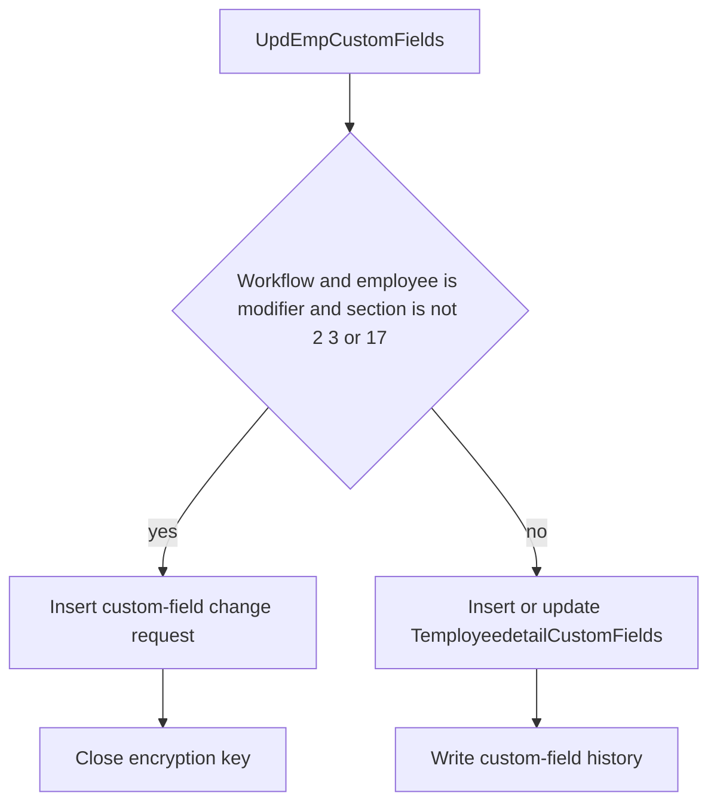

# SP_MyDetails_Enhanced_UpdEmpCustomFields

## What it does

Saves custom-field values for one parent row. Sections 2, 3, and 17 skip the workflow and write `TemployeedetailCustomFields` directly. Family Details is not in that skip list, so an employee editing their own record with an `EmploymentTypeChange` workflow gets a change request. Everyone else gets a direct insert or update plus history.

## Parameters

| Name | Direction | What it is for |
|---|---|---|
| `@EmployeeId` | in | Employee who owns the custom values |
| `@CustDetailId` | in | Parent row id. For family this is the family detail id |
| `@CustFieldID` | in | Change-request id reused as `@RequestID` on the workflow path |
| `@CustomValue` | in | Table of custom field id and value |
| `@EmployerId` | in | Employer. Default null |
| `@ModifiedBy` | in | User applying the change |
| `@SectionID` | in | Section id. Values 2, 3, and 17 skip workflow |

## Call sequence

## Steps

1. Copy `@CustomValue` into a table variable and resolve the `EmploymentTypeChange` workflow into `#tmpFlowDetails` (`STOREPROCEDURE/SP_MyDetails_Enhanced_UpdEmpCustomFields.sql`).
2. When a workflow exists, the employee is the modifier, and `@SectionID` is not 2, 3, or 17, build change-request rows for `TemployeedetailCustomFields`.
3. On that path, open `Sp_OpenEncryptionKeys`, insert `TMyDetailsChangeRequests` and details, resolve approvers with `TVF_Get_AllApprovalsAndNotifications`, insert workflow and email rows, then close the key.
4. Otherwise insert missing `TemployeedetailCustomFields` rows, update rows that already exist for the same employee, field, and parent id, and write `TEmployeedetailCustomFieldshistory`.

## Tables

| Table | Read or write |
|---|---|
| `dbo.Temployeedetail_fields` | read |
| `dbo.TemployeedetailCustomFields` | read and write |
| `dbo.TEmployeedetailCustomFieldshistory` | write |
| `dbo.TWorkflowManagement` | read |
| `dbo.TMyDetailsChangeRequests` | write |
| `dbo.TMyDetailsChangeRequestDetails` | write |
| `dbo.TRequestWorkflows` | write |
| `dbo.TEmailNotification` | write |

## Procedures and functions it calls

| Object | Kind | When | Page |
|---|---|---|---|
| `Sp_OpenEncryptionKeys` | procedure | workflow path | [Sp_OpenEncryptionKeys](/docs/database/hrms/Sp_OpenEncryptionKeys) |
| `TVF_Get_AllApprovalsAndNotifications` | function | workflow path, mode `A` | [TVF_Get_AllApprovalsAndNotifications](/docs/database/hrms/TVF_Get_AllApprovalsAndNotifications) |
| `SP_CloseEncryptionKey` | procedure | end of the workflow path | [SP_CloseEncryptionKey](/docs/database/hrms/SP_CloseEncryptionKey) |

## Flow

