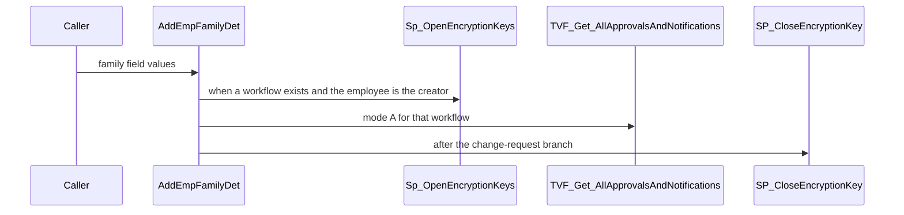
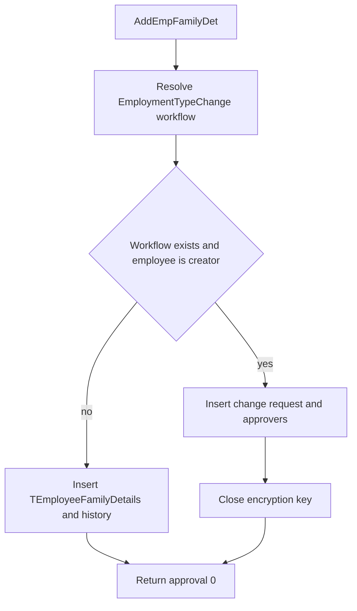

# SP_Mydetails_Enhanced_AddEmpFamilyDet

## What it does

Adds one family member. It looks up the `EmploymentTypeChange` workflow for the employee. When a workflow exists and the employee is the creator, it stores a Personal Information change request instead of inserting `TEmployeeFamilyDetails`. Otherwise it inserts the family row and a history row. The add-family request reaches this procedure only when `sp_executesql` runs the batch from `FN_Mydetails_Enhanced_BuildInsertFamilyDetailsSQL`.

## Parameters

| Name | Direction | What it is for |
|---|---|---|
| `@EmployeeID` | in | Employee who owns the new family row |
| `@Relation` | in | Relationship id |
| `@Student` | in | Student flag |
| `@Name` | in | Family member name |
| `@Insured` | in | Mediclaim-through-company flag. Default 0 |
| `@DateOfBirth` | in | Date of birth. Minor is derived from this date |
| `@Occupation` | in | Occupation text |
| `@Gender` | in | Gender id |
| `@OtherInsurance` | in | Other insurance text |
| `@Dependant` | in | Dependent flag. Default 0 |
| `@GraduationDate` | in | Graduation date |
| `@Address` | in | Address |
| `@Comments` | in | Comments |
| `@Minor` | in | Incoming minor flag. The insert and change request recompute minor from date of birth |
| `@SSN` | in | SSN |
| `@GuardianAddress` | in | Guardian address |
| `@GuardianName` | in | Guardian name |
| `@Smoker` | in | Smoker flag |
| `@CreatedBy` | in | User creating the row. Compared with `@EmployeeID` to decide the approval path |
| `@AadharNumber` | in | Unique identification number |

## Call sequence

## Callers

No other procedure or function calls this object.

## Nested

| Object | Kind | When | Page |
|---|---|---|---|
| `Sp_OpenEncryptionKeys` | procedure | workflow path | [Sp_OpenEncryptionKeys](/docs/database/hrms/Sp_OpenEncryptionKeys) |
| `TVF_Get_AllApprovalsAndNotifications` | function | workflow path, mode `A` | [TVF_Get_AllApprovalsAndNotifications](/docs/database/hrms/TVF_Get_AllApprovalsAndNotifications) |
| `SP_CloseEncryptionKey` | procedure | end of the workflow path | [SP_CloseEncryptionKey](/docs/database/hrms/SP_CloseEncryptionKey) |

## Steps

1. Read the employer from `Temployee` and build `#tmpFlowDetails` for page title `EmploymentTypeChange` (`STOREPROCEDURE/SP_Mydetails_Enhanced_AddEmpFamilyDet.sql`).
2. When `@EmployeeID` is 0, pick the default or non-default workflow mapped to that page. Otherwise record `TMismatchWorkflowTrace`, correct the employer when it differs, and choose a workflow by location and business unit.
3. When a workflow id exists and `@EmployeeID = @CreatedBy`, fill a change-request table for `TEmployeeFamilyDetails`, open `Sp_OpenEncryptionKeys`, insert `TMyDetailsChangeRequests` and details, resolve approvers with `TVF_Get_AllApprovalsAndNotifications`, insert `TRequestWorkflows` and `TEmailNotification`, then close the key.
4. Otherwise insert `TEmployeeFamilyDetails` with `IsDelete = 0`, copy that new id into `TEmployeeFamilyDetails_history`, and return an empty transaction id with approval 0.
5. Drop `#tmpFlowDetails`.

## Tables

| Table | Read or write |
|---|---|
| `dbo.Temployee` | read |
| `dbo.TCustomerSettings` | read |
| `dbo.TModulePages` | read |
| `dbo.TWorkflowManagement` | read |
| `dbo.TMismatchWorkflowTrace` | write |
| `dbo.TEmployeeInfo` | read |
| `dbo.TWorkFlowLocations` | read |
| `dbo.TWorkFlowBusinessUnits` | read |
| `dbo.TEmergencyRelationship` | read |
| `dbo.TMyDetailsChangeRequests` | write |
| `dbo.TMyDetailsChangeRequestDetails` | write |
| `dbo.TRequestWorkflows` | write |
| `dbo.TEmailNotification` | write |
| `dbo.TEmployeeFamilyDetails` | write |
| `dbo.TEmployeeFamilyDetails_history` | write |

## Flow

