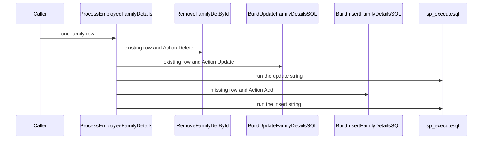
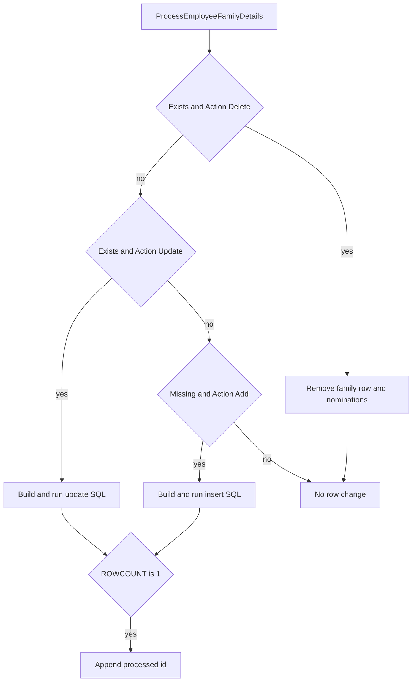

# SP_Mydetails_Enhanced_ProcessEmployeeFamilyDetails

## What it does

Applies one family row. Delete archives custom fields, removes the family row, and soft-deletes linked nominations. Update builds an update statement and runs it. Add builds an insert statement and runs it, then reads the new id from `#SCOPE_VALUE`. The history insert that used to follow a successful row is commented out.

## Parameters

| Name | Direction | What it is for |
|---|---|---|
| `@EmployerID` | in | Employer on the row |
| `@EmployeeData` | in | Full JSON payload passed into the SQL builders |
| `@EmployeeID` | in | Employee who owns the family row |
| `@EmployeeFamilyDetailID_Int` | in | Family id converted to int by the caller |
| `@EmployeeFamilyDetailID_String` | in | Original family id text, used in error logs |
| `@FieldList` | in | Fields included in the built SQL |
| `@IsOverride` | in | Passed to the SQL builders. Add arrives as 0 |
| `@UpdatedBy` | in | User performing the change |
| `@CountryID` | in | Country passed to the SQL builders |
| `@SectionID` | in | Family Details section id |
| `@RecordIndex` | in | Zero-based index of this JSON object |
| `@Action` | in | `Add`, `Update`, or `Delete` |
| `@ProcessedIDs` | out | Appended only when `@@ROWCOUNT` from the dynamic batch is 1 |

## Call sequence

## Steps

1. Treat the int family id as the working id (`STOREPROCEDURE/SP_Mydetails_Enhanced_ProcessEmployeeFamilyDetails.sql`).
2. When the row exists and `Action` is Delete, copy and delete `TEmployeedetailCustomFields`, execute `SP_Mydetails_Enhanced_RemoveFamilyDetById`, copy nominations to history, delete nomination custom fields, and set `TEmployeeNomination.IsDelete = 1`.
3. When the row exists and `Action` is Update, set `@UpdateSQL` from `FN_Mydetails_Enhanced_BuildUpdateFamilyDetailsSQL` and `EXEC sp_executesql` that string.
4. When the row does not exist and `Action` is Add, set `@InsertSQL` from `FN_Mydetails_Enhanced_BuildInsertFamilyDetailsSQL` and `EXEC sp_executesql` that string. Read `SCOPE` from `#SCOPE_VALUE` into the working family id.
5. When `@@ROWCOUNT` is 1, append the employee and family id to `@ProcessedIDs`. The history procedure call under that check is commented out.

## Tables

| Table | Read or write |
|---|---|
| `dbo.TEmployeeFamilyDetails` | read |
| `dbo.TEmployeedetailCustomFields` | read and write on delete |
| `dbo.TEmployeedetailCustomFieldshistory` | write on delete |
| `dbo.TEmployeeNomination` | read and write on delete |
| `dbo.TEmployeeNominationHistory` | write on delete |
| `dbo.TSQL_Errorlogs` | write |
| `#SCOPE_VALUE` | read after the insert batch |

## Procedures and functions it calls

| Object | Kind | When | Page |
|---|---|---|---|
| `SP_Mydetails_Enhanced_RemoveFamilyDetById` | procedure | existing row and Action Delete | [SP_Mydetails_Enhanced_RemoveFamilyDetById](/docs/database/hrms/SP_Mydetails_Enhanced_RemoveFamilyDetById) |
| `FN_Mydetails_Enhanced_BuildUpdateFamilyDetailsSQL` | function | existing row and Action Update | [FN_Mydetails_Enhanced_BuildUpdateFamilyDetailsSQL](/docs/database/hrms/FN_Mydetails_Enhanced_BuildUpdateFamilyDetailsSQL) |
| `FN_Mydetails_Enhanced_BuildInsertFamilyDetailsSQL` | function | missing row and Action Add | [FN_Mydetails_Enhanced_BuildInsertFamilyDetailsSQL](/docs/database/hrms/FN_Mydetails_Enhanced_BuildInsertFamilyDetailsSQL) |

## Unresolved calls

`EXEC sp_executesql` runs the string returned by the insert or update function. Those functions name `SP_Mydetails_Enhanced_AddEmpFamilyDet` and `SP_Mydetails_Enhanced_UpdEmpFamilyDet` inside the string.

## Flow

