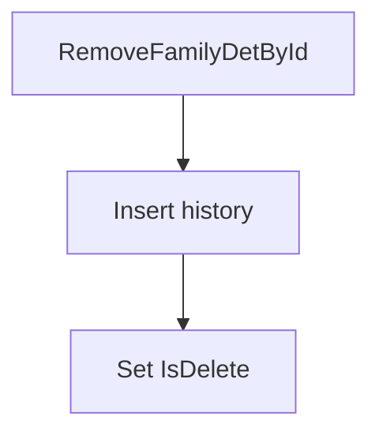

# SP_Mydetails_Enhanced_RemoveFamilyDetById

## What it does

Copies one family row into history and sets `IsDelete` on `TEmployeeFamilyDetails`. The Delete branch of `SP_Mydetails_Enhanced_ProcessEmployeeFamilyDetails` calls it. An Add does not.

## Parameters

| Name | Direction | What it is for |
|---|---|---|
| `@EmployeeFamilyDetailID` | in | Family row to soft-delete |
| `@EmployeeId` | in | Employee who owns the row |
| `@UpdatedBy` | in | User recorded on the update |

## Call sequence

Calls no other procedures or functions.

## Callers

| Object | Kind | Page |
|---|---|---|
| `SP_Mydetails_Enhanced_ProcessEmployeeFamilyDetails` | procedure | [SP_Mydetails_Enhanced_ProcessEmployeeFamilyDetails](/docs/database/hrms/SP_Mydetails_Enhanced_ProcessEmployeeFamilyDetails) |

## Nested

Calls no other procedures or functions.

## Steps

1. Insert the current row into `TEmployeeFamilyDetails_history` (`STOREPROCEDURE/SP_Mydetails_Enhanced_RemoveFamilyDetById.sql`).
2. Set `IsDelete = 1` and stamp `UpdatedBy` and the updated dates.

## Tables

| Table | Read or write |
|---|---|
| `dbo.TEmployeeFamilyDetails` | read and write |
| `dbo.TEmployeeFamilyDetails_history` | write |

## Flow

