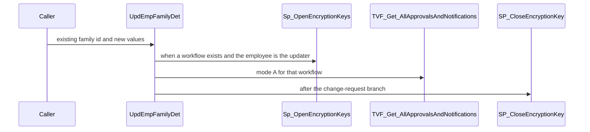
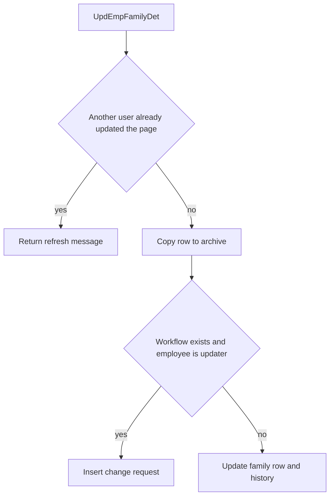

# SP_Mydetails_Enhanced_UpdEmpFamilyDet

## What it does

Updates one existing family row. It archives the current row, then either files an `EmploymentTypeChange` change request or writes `TEmployeeFamilyDetails` and history. The Update branch reaches this procedure only when `sp_executesql` runs the batch from `FN_Mydetails_Enhanced_BuildUpdateFamilyDetailsSQL`. An Add does not call it.

## Parameters

| Name | Direction | What it is for |
|---|---|---|
| `@EmployeeID` | in | Employee who owns the family row |
| `@EmployeeFamilyDetailID` | in | Existing family id |
| `@Relation` | in | Relationship id |
| `@Student` | in | Student flag |
| `@Name` | in | Family member name |
| `@Insured` | in | Mediclaim-through-company flag |
| `@DateOfBirth` | in | Date of birth |
| `@Occupation` | in | Occupation text |
| `@Gender` | in | Gender id |
| `@OtherInsurance` | in | Other insurance text |
| `@Dependant` | in | Dependent flag |
| `@GraduationDate` | in | Graduation date |
| `@Address` | in | Address |
| `@Comments` | in | Comments |
| `@Minor` | in | Incoming minor flag. The direct update recomputes minor from date of birth |
| `@SSN` | in | SSN |
| `@GuardianAddress` | in | Guardian address |
| `@GuardianName` | in | Guardian name |
| `@Smoker` | in | Smoker flag |
| `@UpdatedBy` | in | User applying the change |
| `@updatedDate` | in | Caller-supplied updated date used by the generated batch |

## Call sequence

## Steps

1. Return a refresh message when the concurrency count says another user already changed the page (`STOREPROCEDURE/SP_Mydetails_Enhanced_UpdEmpFamilyDet.sql`).
2. When the family row exists, copy it to `TEmployeeFamilyDetails_Arc` and collect linked nominee ids.
3. Resolve the `EmploymentTypeChange` workflow the same way as the add procedure.
4. When a workflow exists and the employee is the updater, open `Sp_OpenEncryptionKeys`, insert the change request, resolve approvers with `TVF_Get_AllApprovalsAndNotifications`, then close the key.
5. Otherwise copy the live row to `TEmployeeFamilyDetails_history` and update `TEmployeeFamilyDetails`.

## Tables

| Table | Read or write |
|---|---|
| `dbo.TEmployeeFamilyDetails` | read and write |
| `dbo.TEmployeeFamilyDetails_Arc` | write |
| `dbo.TEmployeeFamilyDetails_history` | write |
| `dbo.TEmployeeNominee_Details` | read |
| `dbo.Temployee` | read |
| `dbo.TWorkflowManagement` | read |
| `dbo.TMyDetailsChangeRequests` | write |
| `dbo.TMyDetailsChangeRequestDetails` | write |
| `dbo.TRequestWorkflows` | write |
| `dbo.TEmailNotification` | write |

## Procedures and functions it calls

| Object | Kind | When | Page |
|---|---|---|---|
| `Sp_OpenEncryptionKeys` | procedure | workflow path | [Sp_OpenEncryptionKeys](/docs/database/hrms/Sp_OpenEncryptionKeys) |
| `TVF_Get_AllApprovalsAndNotifications` | function | workflow path, mode `A` | [TVF_Get_AllApprovalsAndNotifications](/docs/database/hrms/TVF_Get_AllApprovalsAndNotifications) |
| `SP_CloseEncryptionKey` | procedure | end of the workflow path | [SP_CloseEncryptionKey](/docs/database/hrms/SP_CloseEncryptionKey) |

## Flow

