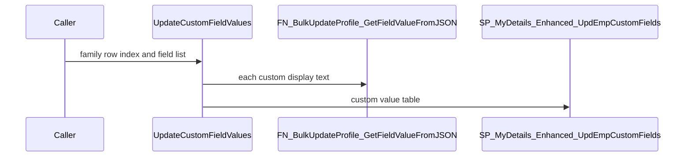
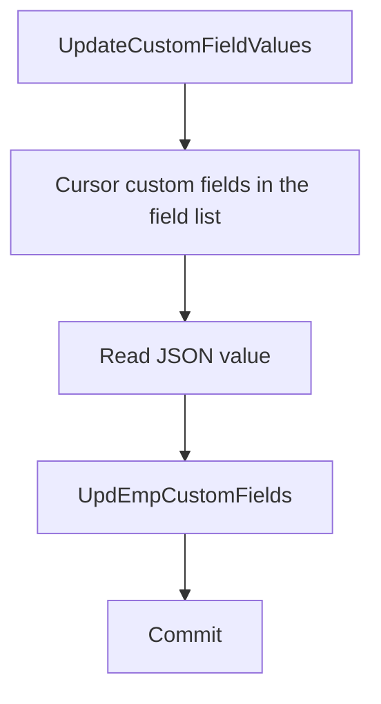

# SP_Mydetails_Enhanced_UpdateCustomFieldValues

## What it does

Reads custom-field display texts from the same JSON payload and passes the collected values to `SP_MyDetails_Enhanced_UpdEmpCustomFields`. Family Add and Update always call this procedure after the family row processor. Dropdown and radio values (field types 2 and 7) are matched to `TEmployeedetailCustomFieldValues`. Other types keep the submitted text.

## Parameters

| Name | Direction | What it is for |
|---|---|---|
| `@EmployerID` | in | Employer whose custom fields are read |
| `@RecordIndex` | in | JSON array index for this family row |
| `@EmployeeID` | in | Employee who owns the values |
| `@CustFieldID` | in | Change-request transaction id collected by the family processor. Default null |
| `@CustDetailId` | in | Family detail id used as the custom-field parent. Default null |
| `@EmployeeData` | in | JSON payload |
| `@FieldList` | in | Display texts the caller submitted |
| `@IsOverride` | in | Present on the signature. The blank-optional check does not use it |
| `@UpdatedBy` | in | User passed as `@ModifiedBy` |
| `@CountryID` | in | Country filter on custom fields |
| `@SectionID` | in | Section filter. Family Details stays on the workflow path inside the callee |

## Call sequence

## Callers

| Object | Kind | Page |
|---|---|---|
| `Usp_Mydetails_Enhanced_ProcessEmployeesBankDetailInformation` | procedure | No page yet |
| `Usp_Mydetails_Enhanced_ProcessEmployeesCertificationInformation` | procedure | No page yet |
| `Usp_Mydetails_Enhanced_ProcessEmployeesContactInformation` | procedure | No page yet |
| `Usp_Mydetails_Enhanced_ProcessEmployeesDomainInformation` | procedure | No page yet |
| `Usp_Mydetails_Enhanced_ProcessEmployeesEducationInformation` | procedure | No page yet |
| `Usp_Mydetails_Enhanced_ProcessEmployeesEmergencyContactInformation` | procedure | No page yet |
| `Usp_Mydetails_Enhanced_ProcessEmployeesFamilyInformation` | procedure | [Usp_Mydetails_Enhanced_ProcessEmployeesFamilyInformation](/docs/database/hrms/Usp_Mydetails_Enhanced_ProcessEmployeesFamilyInformation) |
| `Usp_Mydetails_Enhanced_ProcessEmployeesNominationInformation` | procedure | No page yet |
| `Usp_Mydetails_Enhanced_ProcessEmployeesNomineeInformation` | procedure | No page yet |
| `Usp_Mydetails_Enhanced_ProcessEmployeesPastEmploymentInformation` | procedure | No page yet |
| `Usp_Mydetails_Enhanced_ProcessEmployeesSkillsInformation` | procedure | No page yet |
| `Usp_Mydetails_Enhanced_UpdateAdditionalInfo` | procedure | No page yet |
| `Usp_Mydetails_Enhanced_UpdateCurrentEmploymentDetails` | procedure | No page yet |
| `Usp_Mydetails_Enhanced_UpdateEmployeeDetails` | procedure | No page yet |
| `Usp_Mydetails_Enhanced_UpdateEmployeePassportInformation` | procedure | No page yet |
| `Usp_Mydetails_Enhanced_UpdateEmployeeVisaInformation` | procedure | No page yet |

## Nested

| Object | Kind | When | Page |
|---|---|---|---|
| `FN_BulkUpdateProfile_GetFieldValueFromJSON` | function | each custom field in the cursor | [FN_BulkUpdateProfile_GetFieldValueFromJSON](/docs/database/hrms/FN_BulkUpdateProfile_GetFieldValueFromJSON) |
| `SP_MyDetails_Enhanced_UpdEmpCustomFields` | procedure | after the cursor, including when no custom values were collected | [SP_MyDetails_Enhanced_UpdEmpCustomFields](/docs/database/hrms/SP_MyDetails_Enhanced_UpdEmpCustomFields) |

## Steps

1. Split `@FieldList` and cursor active custom fields for the employer, section, and country (`STOREPROCEDURE/SP_Mydetails_Enhanced_UpdateCustomFieldValues.sql`).
2. Read each value with `FN_BulkUpdateProfile_GetFieldValueFromJSON`. A blank optional value becomes null and is skipped.
3. For field types 2 and 7, resolve submitted tokens to `CustomValueID`. For other types, keep the text.
4. Insert the pairs into `#CustomValues`, then execute `SP_MyDetails_Enhanced_UpdEmpCustomFields`.
5. Commit `Tran_Insert_update_CustomFields`. On failure, roll back and insert `TSQL_Errorlogs`.

## Tables

| Table | Read or write |
|---|---|
| `dbo.TEmployeeDetail_Fields` | read |
| `dbo.TEmployeedetailCustomFieldValues` | read |
| `dbo.TSQL_Errorlogs` | write |
| `#CustomValues` | write |

## Flow

