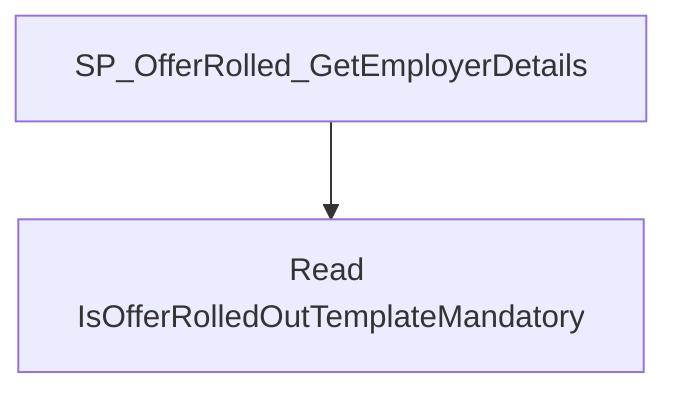

# SP_OfferRolled_GetEmployerDetails

## What it does

Returns the employer flag `IsOfferRolledOutTemplateMandatory` from `TEmployerDetails` for Offer Rolled Out template enforcement in the UI.

## Parameters

| Name | Direction | What it is for |
|---|---|---|
| `@EmployerId` | in | Employer to read |

## Call sequence

Calls no other procedures or functions.

## Callers

No other procedure or function calls this object.

## Nested

Calls no other procedures or functions.

## Steps

1. `SET NOCOUNT ON`.
2. Select `IsOfferRolledOutTemplateMandatory` from `TEmployerDetails` for `@EmployerId`.

## Tables

| Table | Read or write |
|---|---|
| `TEmployerDetails` | read |

## Flow

