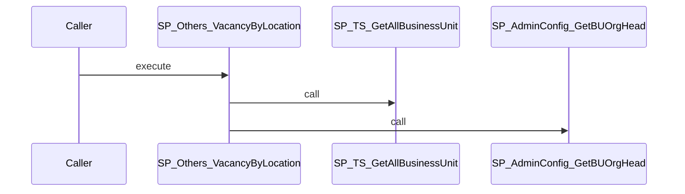
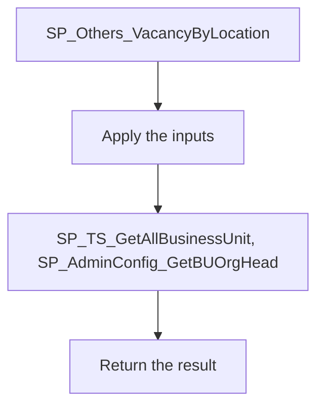

# SP_Others_VacancyByLocation

## What it does

Counts open recruitment vacancies by location for the employers and business units in the filter, between the given dates.

## Parameters

| Name | Direction | What it is for |
|---|---|---|
| `@EmployerIds` | in | Comma-separated employer ids in the chart filter (`VARCHAR(100)`) |
| `@Employeeid` | in | Employee the Home screen is loading or acting for (`INT`) |
| `@BusinessUnitId` | in | Business-unit filter (`VARCHAR(MAX)`) |
| `@FromDate` | in | Filter start date (`Date`) |
| `@ToDate` | in | Filter end date (`Date`) |

## Call sequence

## Callers

No other procedure or function under STOREPROCEDURE or FUNCTIONS executes this object.

## Nested

| Object | Kind | When | Page |
|---|---|---|---|
| `SP_TS_GetAllBusinessUnit` | procedure | Called while this object runs | [SP_TS_GetAllBusinessUnit](/docs/database/hrm-timeport/SP_TS_GetAllBusinessUnit) |
| `SP_AdminConfig_GetBUOrgHead` | procedure | Called while this object runs | [SP_AdminConfig_GetBUOrgHead](/docs/database/hrms/SP_AdminConfig_GetBUOrgHead) |

## Steps

In `HRMS-DATABASE/HRMS/STOREPROCEDURE/SP_Others_VacancyByLocation.sql`:

1. Counts open recruitment vacancies by location for the employers and business units in the filter, between the given dates.

## Tables

| Table | Read or write |
|---|---|
| `Tusers` | read |
| `TUserEmployee` | read |
| `TEmployerDetails` | read |
| `TRRSDetails` | read |
| `TLocation` | read |
| `TOrgHierarchyDetails` | read |

## Flow

