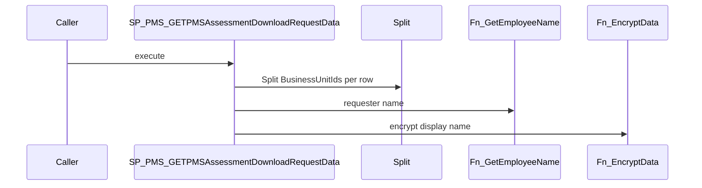
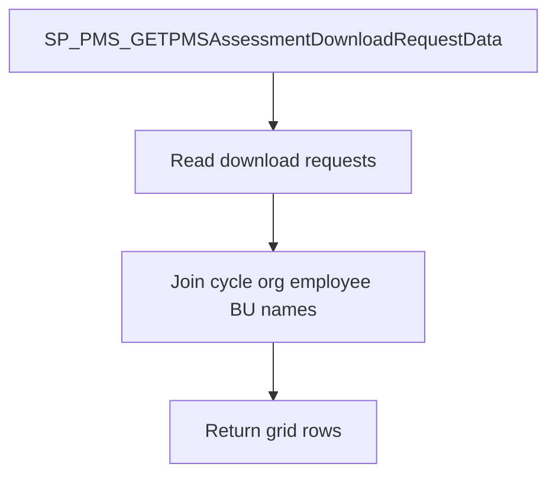

# SP_PMS_GETPMSAssessmentDownloadRequestData

## What it does

Lists Assessment Status download requests for an employer: cycle name, organisation, requester (encrypted name + employment number), status, assessment type, file path, image URL, and a comma-separated business-unit name list from `BusinessUnitIds`.

## Parameters

| Name | Direction | What it is for |
|---|---|---|
| `@EmployerId` | in | Employer whose requests are listed |

## Call sequence

## Callers

No other procedure or function calls this object.

## Nested

| Object | Kind | When | Page |
|---|---|---|---|
| `Split` | function | expand `BusinessUnitIds` | [Split](/docs/database/hrms/Split) |
| `Fn_GetEmployeeName` | function | requester name | [Fn_GetEmployeeName](/docs/database/hrms/Fn_GetEmployeeName) |
| `Fn_EncryptData` | function | wrap display name | [Fn_EncryptData](/docs/database/hrms/Fn_EncryptData) |

## Steps

Definition read from DEV `OBJECT_DEFINITION` (no inventoried `.sql` in `HRMS-DATABASE`).

1. Select from `TPMSAssessmentDownloadRequestData` for `@EmployerId`.
2. Resolve cycle name, employer name, employment number, and STUFF-concatenated BU unit names via `Split` + `TOrgHierarchyDetails`.
3. Order by `RequestDataId` descending.

## Tables

| Table | Read or write |
|---|---|
| `TPMSAssessmentDownloadRequestData` | read |
| `TPMSAppraisalCycles` | read |
| `TPMSEmployerConfiguration` | read |
| `TEmployeeInfo` | read |
| `TOrgHierarchyDetails` | read |

## Unresolved calls

None. Source script is missing from the Liquibase inventory (sibling `SP_PMS_GETPMSAssessmentReportRequestData` is inventoried).

## Flow

