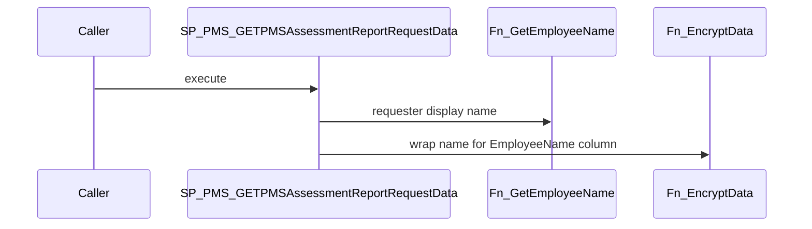
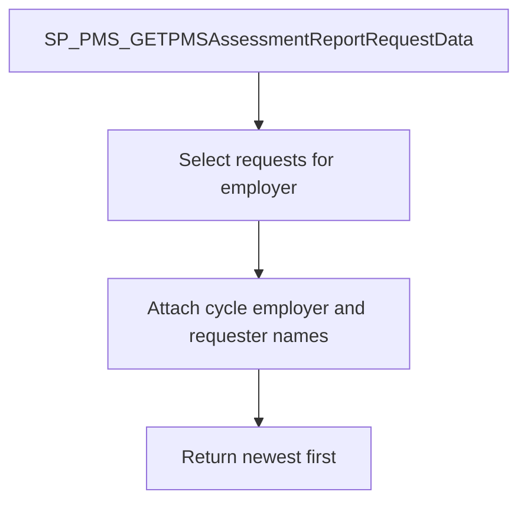

# SP_PMS_GETPMSAssessmentReportRequestData

## What it does

Lists Assessment Report export requests for one employer, newest first, with cycle name, employer name, encrypted requester display name plus employment number, status, assessment type, and `FilePath`.

## Parameters

| Name | Direction | What it is for |
|---|---|---|
| `@EmployerId` | in | Employer whose request rows are returned |

## Call sequence

## Callers

No other procedure or function calls this object.

## Nested

| Object | Kind | When | Page |
|---|---|---|---|
| `Fn_GetEmployeeName` | function | build requester name | [Fn_GetEmployeeName](/docs/database/hrms/Fn_GetEmployeeName) |
| `Fn_EncryptData` | function | wrap requester name in result | [Fn_EncryptData](/docs/database/hrms/Fn_EncryptData) |

## Steps

1. Select from `TPMSAssessmentReportRequestData` where `EmployerId = @EmployerId`.

2. Resolve `CycleName` from `TPMSAppraisalCycles` and `EmployerName` from `TPMSEmployerConfiguration`.

3. Build `EmployeeName` as encrypted `Fn_GetEmployeeName(RequestedBy)` plus employment number from `TEmployeeInfo`.

4. Return `ReportRequestDataId`, cycle/employer fields, `RequestedBy`, `CreatedDate`, `Status`, `AssessmentType`, `FilePath`, ordered by id descending.

## Tables

| Table | Read or write |
|---|---|
| `TPMSAssessmentReportRequestData` | read |
| `TPMSAppraisalCycles` | read |
| `TPMSEmployerConfiguration` | read |
| `TEmployeeInfo` | read |

## Flow

