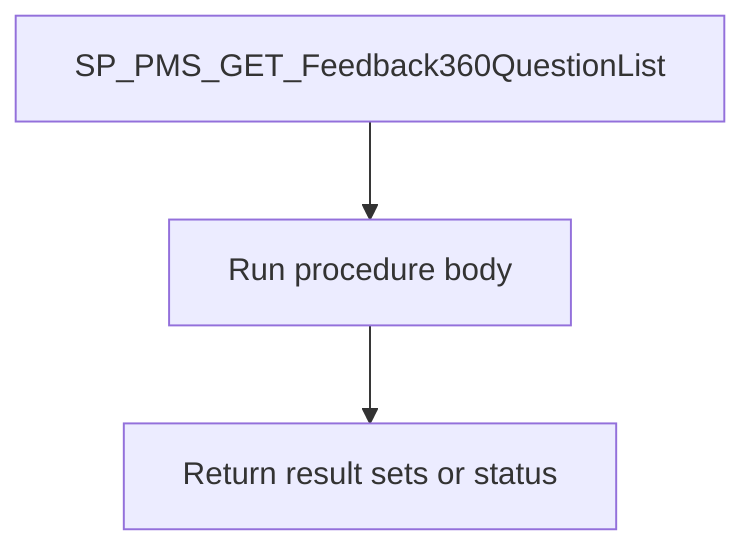

# SP_PMS_GET_Feedback360QuestionList

## What it does

The question bank for one campaign, with the reviewer roles each

## Parameters

| Name | Direction | What it is for |
|---|---|---|
| `@CampaignId` | in | `INT` |
| `@EmployerId` | in | `INT` |
| `@IncludeInactive` | in | `BIT` |

## Call sequence

Calls no other procedures or functions.

## Callers

Application caller: Core API `Feedback360DAL` / `Feedback360Service` for the Performance Assessment → 360° Feedback React module (`Feedback360.aspx`).

| Object | Kind | Page |
|---|---|---|
| _(application)_ | Core API | [360° Feedback guide](/docs/guides/performance-assessment/360-feedback) |

## Nested

Calls no other procedures or functions.

## Steps

1. Runs the statements in the procedure body and returns result sets.
2. Script path: `HRMS-DATABASE/HRMS/STOREPROCEDURE/360Feedback/V1/SP_PMS_GET_Feedback360QuestionList.sql`.

## Tables

| Table | Read or write |
|---|---|
| `dbo.TPMS_Feedback360Campaign` | read |
| `dbo.TPMS_Feedback360Question` | read |
| `dbo.TPMS_Feedback360QuestionOption` | read |
| `dbo.TPMS_Feedback360QuestionRole` | read |

## Flow

