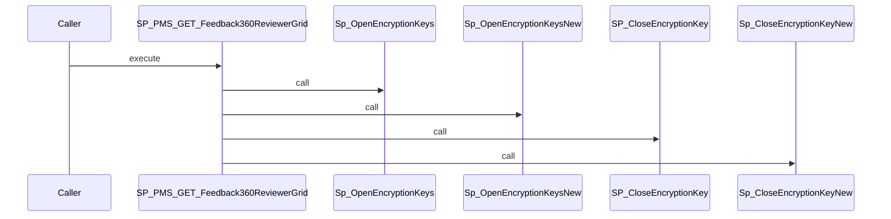
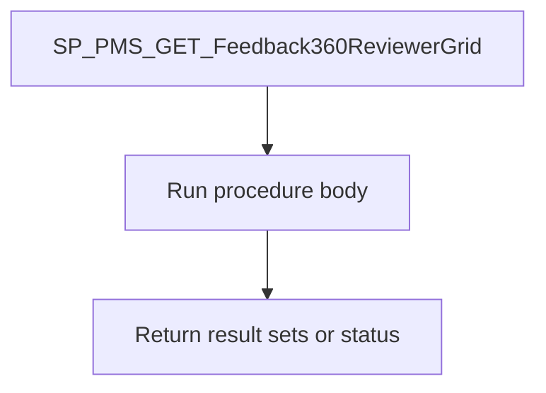

# SP_PMS_GET_Feedback360ReviewerGrid

## What it does

Everything the Assign Reviewers grid renders (wizard step 6 and the

## Parameters

| Name | Direction | What it is for |
|---|---|---|
| `@CampaignId` | in | `INT` |
| `@EmployerId` | in | `INT` |

## Call sequence

## Callers

Application caller: Core API `Feedback360DAL` / `Feedback360Service` for the Performance Assessment → 360° Feedback React module (`Feedback360.aspx`).

| Object | Kind | Page |
|---|---|---|
| _(application)_ | Core API | [360° Feedback guide](/docs/guides/performance-assessment/360-feedback) |

## Nested

| Object | Kind | When | Page |
|---|---|---|---|
| `Sp_OpenEncryptionKeys` | procedure | start/end of batch | [Sp_OpenEncryptionKeys](/docs/database/hrms/Sp_OpenEncryptionKeys) |
| `Sp_OpenEncryptionKeysNew` | procedure | start/end of batch | [Sp_OpenEncryptionKeysNew](/docs/database/hrms/Sp_OpenEncryptionKeysNew) |
| `SP_CloseEncryptionKey` | procedure | start/end of batch | [SP_CloseEncryptionKey](/docs/database/hrms/SP_CloseEncryptionKey) |
| `Sp_CloseEncryptionKeyNew` | procedure | start/end of batch | [Sp_CloseEncryptionKeyNew](/docs/database/hrms/Sp_CloseEncryptionKeyNew) |

## Steps

1. Opens/closes encryption keys around encrypted employee fields.
2. Script path: `HRMS-DATABASE/HRMS/STOREPROCEDURE/360Feedback/V1/SP_PMS_GET_Feedback360ReviewerGrid.sql`.

## Tables

| Table | Read or write |
|---|---|
| `dbo.TEmployee` | read |
| `dbo.TEmployeeInfo` | read |
| `dbo.TPMS_Feedback360Campaign` | read |
| `dbo.TPMS_Feedback360CampaignManagerType` | read |
| `dbo.TPMS_Feedback360Participant` | read |
| `dbo.TPMS_Feedback360Reviewer` | read |
| `dbo.TPMS_Feedback360ReviewerQuestion` | read |
| `dbo.TPMS_Feedback360Submission` | read |

## Flow

