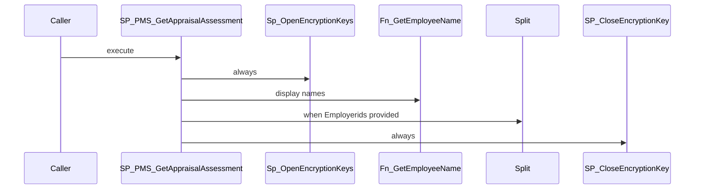
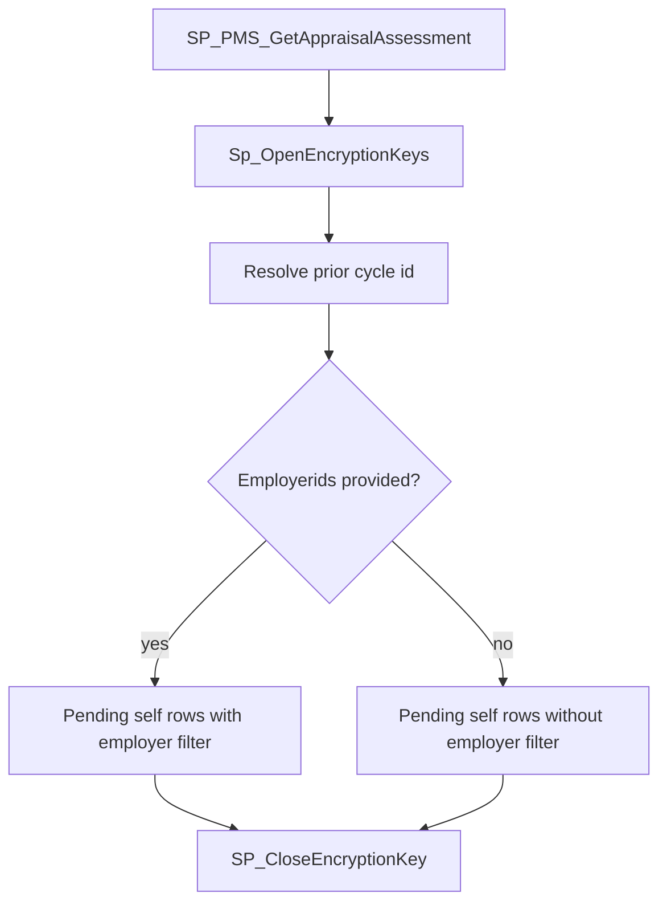

# SP_PMS_GetAppraisalAssessment

## What it does

Lists pending self-appraisal forms for one employee when employer config `IsSelfassessmentIsRequired = 1`, the employee is active, the cycle and review frequency are `Initiated`, and `TPMSEmployeeSelfAppraisal.FormStatus = 'Pending'`. Computes a prior-cycle id for context and flags resubmission / resignation-pullback markers. Optional `@Employerids` filters by employer via `dbo.Split`. Used by Performance Assessment Notifications panel **PSelf**.

## Parameters

| Name | Direction | What it is for |
|---|---|---|
| `@EmployeeId` | in | Employee whose pending self-appraisal forms to list |
| `@Employerids` | in | Optional comma-separated employer ids; when empty, no employer filter |

## Call sequence

## Callers

No other procedure or function calls this object. Application callers include Core API `performanceAssessmentDAL.FetchPendingSelfAssessmentForm` (Performance Assessment Notifications PSelf).

## Nested

| Object | Kind | When | Page |
|---|---|---|---|
| `Sp_OpenEncryptionKeys` | procedure | always | [Sp_OpenEncryptionKeys](/docs/database/hrms/Sp_OpenEncryptionKeys) |
| `SP_CloseEncryptionKey` | procedure | always | [SP_CloseEncryptionKey](/docs/database/hrms/SP_CloseEncryptionKey) |
| `Fn_GetEmployeeName` | function | employee / manager / resubmission display names | [Fn_GetEmployeeName](/docs/database/hrms/Fn_GetEmployeeName) |
| `Split` | function | when `@Employerids` has length | [Split](/docs/database/hrms/Split) |

## Steps

Script: `HRMS-DATABASE/HRMS/STOREPROCEDURE/SP_PMS_GetAppraisalAssessment.sql`.

1. Open encryption keys.
2. Resolve `@Lv_OldCycleId` as the previous self-appraisal cycle for the employee (or 0).
3. If `@Employerids` has length, select pending self-assessment rows with employer filter and self-assessment required.
4. Else select the same without employer filter.
5. Close encryption keys.

## Tables

| Table | Read or write |
|---|---|
| `TPMSEmployeeSelfAppraisal` | read |
| `TPMSAppraisalCycles` | read |
| `TPMSEmployeeAppraisalCycleMapping` | read |
| `TPMS_AppraisalReviewFrequency` | read |
| `TPMS_AppraisalReviewSequence` | read |
| `TPMSEmployerConfiguration` | read |
| `TEmployee` / `TEmployeeInfo` | read |
| `TPMS_EmployeeRejectWorkFlowRequest` | read |
| `TPMS_EmployeeAutoCloseRequest` | read |

## Unresolved calls

None.

## Flow

